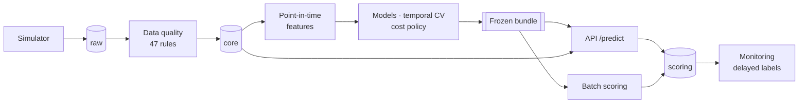

# Transaction Fraud Detection & Risk Scoring Platform

[](https://github.com/JavierMolero12/fraud-detection-platform/actions/workflows/ci.yml)
[](LICENSE)

An end-to-end fraud risk scoring system for card payments. It is built around the problems that
make fraud detection hard in practice: temporal leakage, labels that arrive weeks late, extreme
class imbalance, decisions that should depend on cost, calibration, and drift.

It goes from a scenario-based simulator to SQL data quality, 50 point-in-time features, models
validated in time, a cost-based approve/review/block policy, a real-time API, Docker images with
CI, and monitoring that only uses what is known on each day. **Every number in the reports comes
from a recorded run**, including the ones that did not go as expected.

> **The data is synthetic** (2.85M simulated payments). The project demonstrates method, not
> discoveries about real fraud: where the simulator makes a result true by construction, the
> reports say so.

## Results

| | |
|---|---|
| Ranking, validation → the single test evaluation | PR-AUC 0.792 → **0.752** (base rate 0.73%; seven expert rules on validation: 0.256) |
| Cost of the deployed policy on test | **€64,098** vs €946,956 approving everything (−93.2%) and €482,886 for the rules |
| Fraud EUR stopped on test | **95.5%**; real false decline rate 0.036% once label noise is removed |
| Leakage, measured | a model with leaky features scores 0.852 offline and **0.401** in production |
| Real-time API | 44.6 ms p50 per request in Docker; online features identical to training, bit for bit |
| Drift injected in production | the label-based monitoring alerted after **67 days**; input PSI with the usual threshold never did |

The whole story, with its limitations: **[final report](reports/final_report.md)** ·
[model card](reports/model_card.md) · [monitoring report](reports/monitoring/monitoring_report.html).

## Stack

| Area | Tools |
|---|---|
| Language | Python 3.11+ and SQL |
| Data | PostgreSQL 16 (layered schemas), SQL data quality rules, window functions, point-in-time features, pandas, NumPy |
| Machine learning | scikit-learn (logistic regression, HistGradientBoosting), probability calibration, MLflow, SHAP |
| Backend | FastAPI, Uvicorn, Pydantic, psycopg 3, a `fraud` command-line tool (Typer) |
| DevOps | Docker, Docker Compose, GitHub Actions, pytest, ruff |

## How it works



One PostgreSQL database with layered schemas, one `fraud` CLI with a command per step, two Docker
images. Details: [architecture](docs/architecture.md) · [Phase 1 design](docs/phase1_design.md) ·
[decision log](docs/decisions.md) (30 decisions with context and alternatives).

## Quick check (about 5 minutes, Docker only)

Runs the data pipeline and the API on the `tiny` dataset with a stand-in model, exactly as CI
does. It shows that everything wires together, not the model's quality.

```bash
git clone https://github.com/JavierMolero12/fraud-detection-platform.git
cd fraud-detection-platform
docker compose up -d db
docker compose run --rm jobs simulate --scale tiny
docker compose run --rm jobs db init
docker compose run --rm jobs db load data/raw/v1.0.1-tiny
docker compose run --rm jobs dq run
docker compose run --rm jobs features build
docker compose run --rm jobs serve demo-bundle
FRAUD_BUNDLE_HOST_DIR=./data/processed/demo_bundle docker compose up -d api
curl http://localhost:8000/health
docker compose run --rm jobs serve check --url http://api:8000 --bundle-dir data/processed/demo_bundle
```

On Linux, add `FRAUD_UID=$(id -u) FRAUD_GID=$(id -g)` so the files written by the containers are
yours.

## Full reproduction (the numbers in the reports)

The models, the policy and the monitoring need the **full** dataset: the train, validation, test
and production periods ([`configs/splits.yaml`](configs/splits.yaml)) only exist there.
[`docs/reproducibility.md`](docs/reproducibility.md) has the step-by-step commands, the time of
each step, what to expect, and the result of a reproduction from scratch in a clean clone.

Two things to know:
- **The test period has already been evaluated, once** (decision 022). In a fresh clone,
  `fraud policy evaluate-test` refuses to run because the committed record exists; `--force`
  exists but is not part of the reproduction.
- **Give the database memory.** The feature build sorts 2.85M rows several times. On a 16 GB
  laptop with other programs open, a second PostgreSQL instance in the same Docker VM made one
  step stall for hours; alone, it took about 2 minutes.

## Real-time API

`fraud serve api` (or `docker compose up -d api`) starts the service. `POST /predict` takes a
payment as the authorisation system sends it, before it reaches the database. It returns a
calibrated probability, a risk level and the decision with the lowest expected cost for that
amount:

```bash
curl -s http://127.0.0.1:8000/predict -H "Content-Type: application/json" -d '{
  "transaction_id": "demo-0001", "customer_id": "C0024210", "card_id": "K00038141",
  "merchant_id": "M0001305", "timestamp": "2026-06-30T07:43:24+00:00",
  "amount": 8598.49, "currency": "EUR", "country": "IT",
  "payment_method": "ecommerce", "device_id": "D8949a4286eec"}'
```

```json
{"transaction_id": "demo-0001", "fraud_probability": 0.0020404363442641077,
 "risk_level": "low", "decision": "review", "model_version": "fcf88c67457e",
 "policy_version": "65a2111fa8c2", "scoring_timestamp": "2026-10-26T12:15:00.187080Z"}
```

A 0.2% risk is "low", but on €8,598 a review is cheaper than the expected loss: the risk level is
for display, the decision comes from the cost policy. (The ids exist in the full simulated
dataset.)
- Invalid or unknown inputs get a 422.
- A retried `transaction_id` returns the decision already made.
- `GET /health` and `GET /model` (versions, policy, training period, lineage) are also available.
- Interactive docs: `/docs`.

### Payment simulator

With the API running, `fraud serve simulator` serves a page on http://127.0.0.1:8001 that walks
through one payment at a time. It offers twelve batch-scored payments of the production period,
one of each kind (legitimate, each fraud scenario, a missed fraud, a false positive). It sends the
one you pick to `POST /predict` and shows, step by step:

1. what the API receives;
2. its answer: probability, risk level, decision and response time;
3. 14 of the 50 features it logged, all computed from history before the payment;
4. the expected cost of approving, reviewing and blocking;
5. the generator's truth, which the API never reads.

The amount can be changed before sending, to watch the decision move. Each prediction the
simulator causes is deleted right after its answer. The page's text is in Spanish. On a smaller
dataset it offers only the kinds it finds; `--api-url` and `--port` change the addresses.

## What is where

| Area | Code | Results |
|---|---|---|
| Simulator | [`simulation/`](src/fraudplatform/simulation), [`configs/simulation.yaml`](configs/simulation.yaml) | [dataset report](reports/simulation/v1.0.1-full.md) |
| Data quality | [`sql/data_quality/`](sql/data_quality), [`quality/`](src/fraudplatform/quality) | [DQ report](reports/data_quality/dq_report.md) |
| EDA (train period only) | [`notebooks/02_eda.py`](notebooks/02_eda.py), [`sql/analysis/`](sql/analysis) | [findings](reports/eda/eda_findings.md) |
| Point-in-time features (50) | [`sql/features/`](sql/features), [`features/`](src/fraudplatform/features) | [catalogue](docs/feature_catalog.md), [findings](reports/features/feature_findings.md) |
| Models, temporal validation | [`models/`](src/fraudplatform/models), [`configs/model.yaml`](configs/model.yaml) | [Phase 6](reports/models/phase6_findings.md), [Phase 7](reports/models/phase7_findings.md) |
| Calibration, cost policy, the test | [`decision/`](src/fraudplatform/decision), [`configs/costs.yaml`](configs/costs.yaml) | [findings](reports/policy/phase8_findings.md), [test record](reports/policy/test_evaluation.json) |
| Errors and explanations | [`analysis/`](src/fraudplatform/analysis) | [findings](reports/analysis/phase9_findings.md), [model card](reports/model_card.md) |
| API and batch scoring | [`serving/`](src/fraudplatform/serving), [`sql/features/online/`](sql/features/online) | [findings](reports/serving/phase10_findings.md) |
| Docker and CI | [`Dockerfile`](Dockerfile), [`docker-compose.yml`](docker-compose.yml), [`ci.yml`](.github/workflows/ci.yml) | [findings](reports/deployment/phase11_findings.md) |
| Monitoring | [`monitoring/`](src/fraudplatform/monitoring), [`configs/monitoring.yaml`](configs/monitoring.yaml) | [findings](reports/monitoring/phase12_findings.md), [HTML report](reports/monitoring/monitoring_report.html) |

Notebooks are kept as [jupytext](https://jupytext.readthedocs.io) scripts (`notebooks/*.py`) and
executed into `.ipynb` so GitHub shows their outputs.

## How it was built

Phase by phase, one branch and one pull request each; every PR description is in
[`docs/pull_requests/`](docs/pull_requests). Phase 1 was the [design](docs/phase1_design.md).
The description files are numbered by phase; on GitHub the same pull requests are #1 to #14.

| Phase | Pull request description | On GitHub |
|---|---|---|
| 2 · simulator and database | [PR-02](docs/pull_requests/PR-02-simulator-and-db.md) | [#1](https://github.com/JavierMolero12/fraud-detection-platform/pull/1) |
| 3 · data quality and SQL | [PR-03](docs/pull_requests/PR-03-data-quality-sql.md) | [#2](https://github.com/JavierMolero12/fraud-detection-platform/pull/2) |
| 4 · EDA and statistics | [PR-04](docs/pull_requests/PR-04-eda.md) | [#3](https://github.com/JavierMolero12/fraud-detection-platform/pull/3) |
| 5 · temporal features | [PR-05](docs/pull_requests/PR-05-temporal-features.md) | [#4](https://github.com/JavierMolero12/fraud-detection-platform/pull/4) |
| 6 · baselines and models | [PR-06](docs/pull_requests/PR-06-modeling.md) | [#5](https://github.com/JavierMolero12/fraud-detection-platform/pull/5) |
| 7 · temporal validation and tuning | [PR-07](docs/pull_requests/PR-07-temporal-validation.md) | [#6](https://github.com/JavierMolero12/fraud-detection-platform/pull/6) |
| 8 · cost, threshold, calibration | [PR-08](docs/pull_requests/PR-08-cost-threshold-calibration.md) | [#7](https://github.com/JavierMolero12/fraud-detection-platform/pull/7) |
| 9 · error analysis | [PR-09](docs/pull_requests/PR-09-error-analysis.md) | [#8](https://github.com/JavierMolero12/fraud-detection-platform/pull/8) |
| 10 · API and batch scoring | [PR-10](docs/pull_requests/PR-10-api-and-batch.md) | [#9](https://github.com/JavierMolero12/fraud-detection-platform/pull/9) |
| 11 · Docker and CI | [PR-11](docs/pull_requests/PR-11-docker-ci.md) | [#10](https://github.com/JavierMolero12/fraud-detection-platform/pull/10) |
| 12 · monitoring | [PR-12](docs/pull_requests/PR-12-monitoring.md) | [#11](https://github.com/JavierMolero12/fraud-detection-platform/pull/11) |
| 13 · documentation | [PR-13](docs/pull_requests/PR-13-documentation.md) | [#12](https://github.com/JavierMolero12/fraud-detection-platform/pull/12) |
| 14 · tech-lead review | [PR-14](docs/pull_requests/PR-14-tech-lead-review.md) | [#13](https://github.com/JavierMolero12/fraud-detection-platform/pull/13) |
| After 14 · payment simulator | [PR-15](docs/pull_requests/PR-15-payment-simulator.md) | [#14](https://github.com/JavierMolero12/fraud-detection-platform/pull/14) |

## Tests

```bash
pip install -e ".[train,dev]"
pytest                                   # unit tests
docker compose up -d db
pytest -m integration                    # against a throwaway database on the same server
pytest -m "integration or not integration" --cov=fraudplatform
ruff check . && ruff format --check .
```

CI runs all of it on every pull request. It then builds both Docker images and tests them end to
end.

## Limitations

- **Synthetic data:** one simulator, one seed, one drift scenario.
- **No retraining was run:** the monitoring says when, not whether it helps.
- **Measured on a laptop:** latency and timings come from a shared machine.
- **Not hardened for exposure:** the API has no authentication.

The full list is in the [final report](reports/final_report.md#13-limitations). A
[tech-lead review](docs/tech_lead_review.md) scores each area and ranks what to fix before real
traffic.

## Author

Javier Molero Moreno · [GitHub](https://github.com/JavierMolero12)

## License

[MIT](LICENSE).
