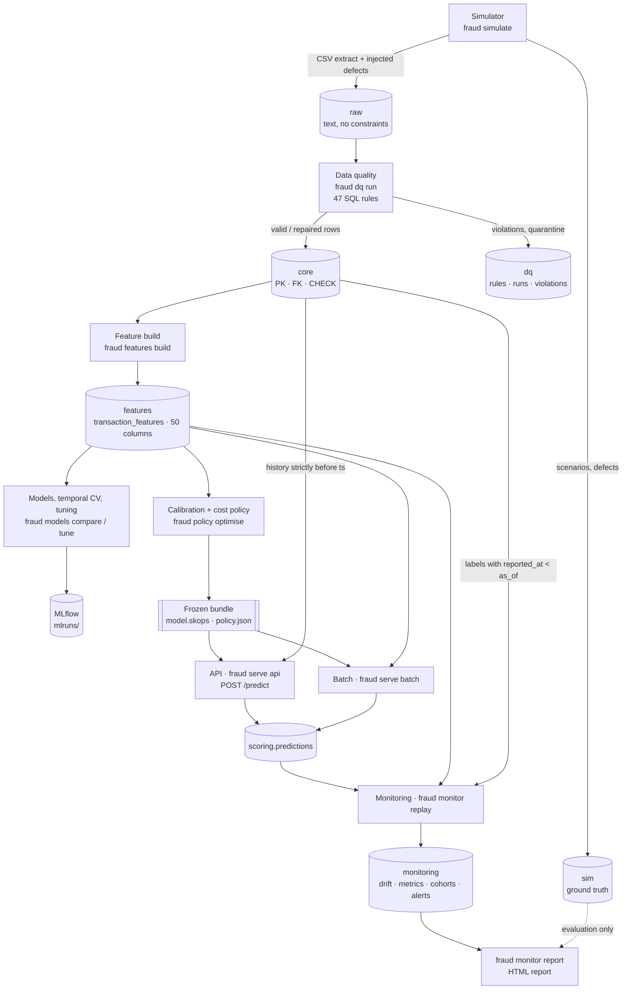
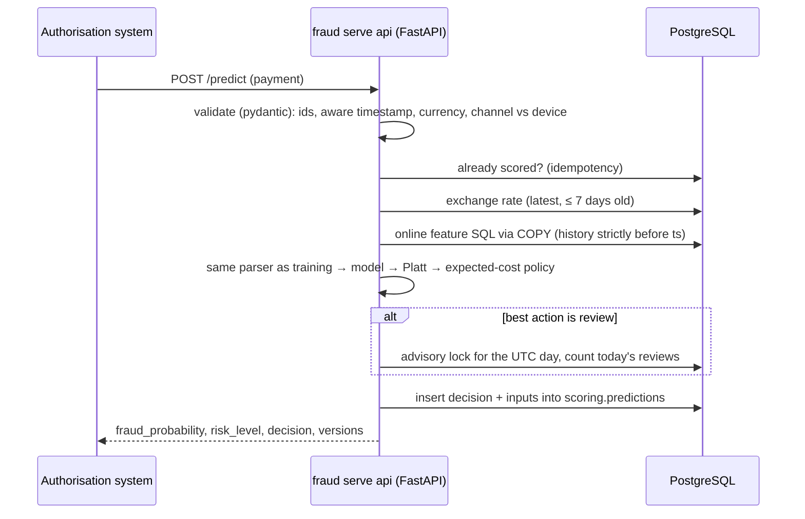
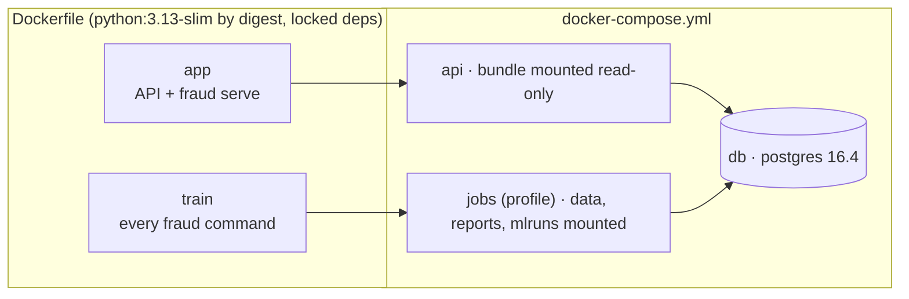

# Architecture (as built)

The system as it exists after Phase 13. The plan it started from is
[`phase1_design.md`](phase1_design.md); what changed and why is at the end of this page, with the
detail in [`decisions.md`](decisions.md).

## 1. Components and data flow

Every step is a `fraud` CLI command ([`cli.py`](../src/fraudplatform/cli.py)); orchestration is the
order of the commands, run by hand, by CI or by `docker compose run jobs`.

## 2. Storage: one PostgreSQL database, layered schemas

Data only moves forward. Each layer is created by `fraud db init` from
[`sql/schema/`](../sql/schema) and filled by one command.

| Schema | Filled by | Main tables | Guarantees |
|---|---|---|---|
| `raw` | `fraud db load` | `customers`, `cards`, `merchants`, `devices`, `transactions`, `fraud_labels`, `load_log` | none: everything as text, so that bad rows can be loaded and detected |
| `dq` | `fraud dq run` | `rules` (47, each with an action), `violations`, `runs`, `table_stats`, staging and clean tables | every rejected or repaired row is traceable to a rule |
| `core` | `fraud dq run` | `customers`, `cards`, `merchants`, `devices`, `transactions`, `fraud_labels`, `countries`, `currencies`, `fx_rates` | PK, FK (card belongs to customer), CHECK, (entity, ts) indexes |
| `features` | `fraud features build` | `transaction_features` (50 features), `transaction_features_leaky` (control experiment), `builds` | point-in-time: history strictly before `ts`, labels with `reported_at < ts` |
| `scoring` | `fraud serve api`, `fraud serve batch` | `predictions` (versions, decision, time to decision, the 50 inputs as JSON) | idempotent API retries (unique index) |
| `monitoring` | `fraud monitor replay` / `run` | `feature_drift`, `metrics`, `label_cohorts`, `alerts` | a run on date D used only data with `ts < D` and `reported_at < D` |
| `sim` | `fraud db load` | `ground_truth` (scenario of every fraud), `dq_defects` | read only by evaluation code (Phase 3 DQ recall, Phase 9 errors, Phase 12 alert evaluation); a test enforces it |

Configuration that would otherwise hide in code lives in [`configs/`](../configs): simulation,
splits, features, model, costs (business assumptions), serving and monitoring thresholds.

## 3. Offline pipeline

| Step | Command | What it produces | Where |
|---|---|---|---|
| Simulate | `fraud simulate --scale full` | 2.87M raw transactions, 24 months, injected defects and drift | `simulation/`, `data/raw/v1.0.1-full/` |
| Load | `fraud db load` | `raw` + `sim` | `db.py` |
| Data quality | `fraud dq run` | `core`, `dq`, the DQ report | `sql/data_quality/`, `quality/` |
| Features | `fraud features build` | `features.transaction_features` | `sql/features/10..50_*.sql`, `features/` |
| Compare | `fraud models compare` | baselines and models on validation, MLflow runs | `models/comparison.py` |
| Tune | `fraud models tune` | temporal CV, tuning, leakage experiments H7/H8 | `models/validation.py`, `models/tuning.py` |
| Policy | `fraud policy optimise` | calibration, P1 vs P2, sensitivity, **the frozen bundle** | `decision/` |
| Test (once) | `fraud policy evaluate-test` | `reports/policy/test_evaluation.json`; refuses to run again | `decision/test_evaluation.py` |
| Analysis | `fraud analyse validation` | explanations, error and segment analysis | `analysis/` |

The frozen bundle is `data/processed/phase8/` (`model.skops`, `policy.json`, validation scores).
It is not in git; its hashes are, in [`reports/policy/frozen_bundle.sha256`](../reports/policy/frozen_bundle.sha256).

## 4. Serving path (one payment)

- **Same features as training, bit for bit.** The online SQL
  ([`single_transaction.sql`](../sql/features/online/single_transaction.sql)) mirrors the offline
  build and is read through the same COPY → CSV → pandas function (decision 024).
- **Processes, not threads.** `fraud serve api` runs uvicorn with N worker processes and a listening
  socket declared as TCP. Plain `uvicorn --workers` lost `TCP_NODELAY` and added ~40 ms per request
  (decision 027).
- **Batch scoring** (`fraud serve batch`) reads `features.transaction_features` with the same bundle
  and ranks each day's reviews by benefit. The API hands review slots out first come, first served.
  They decide the same while capacity does not bind (decision 025).

## 5. Monitoring

A weekly run as of date D (`monitoring/run.py`) computes:
- input and score PSI against the validation period;
- decision rates;
- delay-adjusted calibration (reported vs expected frauds given the reporting-delay distribution);
- recall on mature cohorts.

It then applies the rules of [`configs/monitoring.yaml`](../configs/monitoring.yaml).
`fraud monitor replay` runs all weeks since deployment. `fraud monitor report` judges the alerts
against the injected drift: only this step reads the simulator's truth.

## 6. Packaging, CI and environments

**CI** ([`ci.yml`](../.github/workflows/ci.yml)), on every PR, in two jobs.

The first job:
- runs ruff, then unit and integration tests (PostgreSQL service);
- reports coverage.

The second job, only after the first passes:
- builds both images;
- runs the pipeline in containers on the tiny dataset;
- starts the API container and checks it against batch scoring;
- runs a latency guard.

## 7. Package map

| Package | Responsibility |
|---|---|
| `simulation/` | Entities, legitimate behaviour, fraud scenarios, labels with delay and noise, injected defects, drift |
| `quality/` | Runs the DQ SQL, writes the report (rule recall against injected defects) |
| `eda/` | Data access (`load_features`, `query_features`), statistics (Wilson, Cramér's V, BH), plots |
| `features/` | Feature catalogue (single source of the 50 columns) and build orchestration |
| `models/` | Baselines, pipelines, metrics with day-block bootstrap, temporal CV, tuning, MLflow tracking |
| `decision/` | Cost model, calibration, P1/P2 policies, sensitivity, the one-time test evaluation |
| `analysis/` | SHAP (permutation) and permutation importance, errors with the simulator truth, segments |
| `serving/` | Online features, scorer, API, batch, idempotency and capacity, checks, benchmark, launcher |
| `monitoring/` | Drift, delayed labels, weekly runs and replay, evaluation against the truth, HTML report |

## Deviations from the Phase 1 design

| Planned | Built | Why |
|---|---|---|
| `raw.quarantine` | A `dq` schema with rules, violations, runs and staging | Every rejected or repaired row is traceable to a named rule with an action (decision 011) |
| One SQL definition per feature, applied offline and online | Two implementations (window functions offline, lookups online) with an exact parity test | The efficient form for 2.85M rows does not work for one row, and vice versa (decisions 017, 024) |
| `api/` and `scoring/` packages | One `serving/` package | The scorer is shared by the API and the batch job |
| CLI `fraud simulate \| load \| dq \| features \| train \| score \| monitor` | `fraud simulate \| db \| dq \| features \| models \| policy \| analyse \| serve \| monitor` | One group per phase, with sub-commands |
| `data/sample/` and notebooks `01..05` | No sample folder; notebooks `02..07` (EDA, features, models, temporal validation, cost and calibration, errors) | Every dataset is regenerated from a seed; DQ has a report instead of a notebook |
| Class weights and threshold tuning | No class weights or resampling at all | Weights hurt PR-AUC and destroyed calibration (decision 018) |
| SHAP | SHAP `PermutationExplainer` with an additivity check | `TreeExplainer` is silently wrong for native categorical splits (decision 023) |
| A warm-up was not planned | 92 days of history excluded from training | Truncated history makes everything look new at the start (decision 016) |
| Optional Sparkov sanity check | Not done | It was optional and was never prioritised; the synthetic-data caveat stands |
| `uvicorn --workers` in Docker | `fraud serve api` launcher | Workers lost `TCP_NODELAY`, +40 ms per request (decision 027) |
| One image | `app` and `train` images | The API does not need the training stack (decision 027) |
| H9: PSI detects the drift before the labels | Not supported with the rules fixed in advance | The labels detected it after 67 days; PSI showed a step below the conventional threshold (decision 030) |
