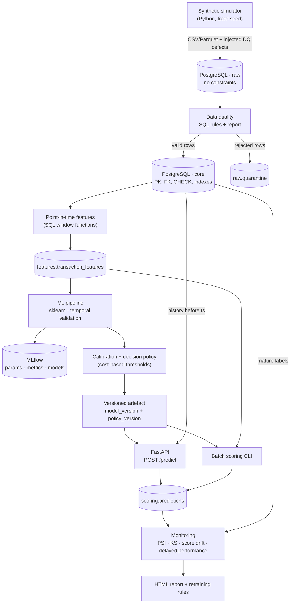
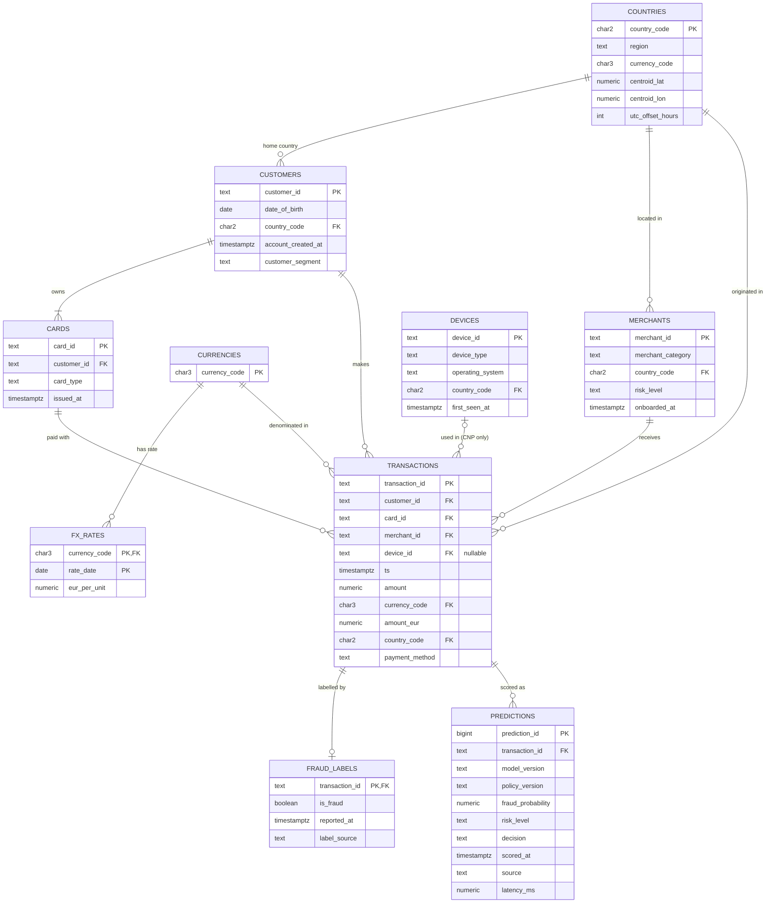

# Phase 1 — Technical design

**Project:** Transaction Fraud Detection & Risk Scoring Platform
**Status:** the design validated before any code was written (2026-10-20), kept as the original
plan. What changed while building it is listed in [`architecture.md`](architecture.md#deviations-from-the-phase-1-design).
**Language:** translated from the Spanish original in Phase 13; the content is unchanged.

> Honesty rule: this document contains **no results**. Every number in it is either a **design
> assumption** (marked as such) or a **target** to be verified empirically.

---

## 0. Summary of decisions

| Topic | Decision | Why (one line) |
|---|---|---|
| Data | Own synthetic simulator built on **fraud scenarios**, ~3M transactions, 24 months, ~1% fraud | No public dataset has customers + cards + merchants + devices + real time |
| Labels | Separate `fraud_labels` table with **`reported_at`** (labels arrive late) | That is how real fraud works (chargebacks); it is the subtlest source of leakage |
| Database | PostgreSQL 16 in Docker, schemas `raw` → `core` → `features` → `scoring` → `monitoring` | Window functions with `RANGE INTERVAL`, real constraints, free and standard |
| Features | Defined in **point-in-time SQL** (strictly earlier history only), same definitions offline and online | Prevents leakage and training/serving skew; a parity test checks it |
| Validation | Train 12m → Validation 3m → Test 3m → **Simulated production 6m with drift** | Temporal validation, plus a real "six months later" period for monitoring |
| Model metric | PR-AUC (Average Precision) | With 1% fraud, accuracy and ROC-AUC mislead |
| Business metric | Expected cost in € **depending on the amount** + **limited review capacity** | Letting a €3 fraud through does not cost the same as a €2,000 one |
| Decision | approve / review / block optimised on cost, not fixed thresholds | A 0.5 threshold makes no sense with a 1% base rate |
| Tracking | Local MLflow | Compare experiments by dataset / feature / model version |
| Out of scope | Kafka, Airflow, Spark, Kubernetes, feature store, cloud | They solve no problem we have at this scale |

---

## 1. Business problem

### 1.1 Context
A (fictitious) European fintech issues cards and processes their payments. Every transaction
goes through an authorisation engine that must decide on the spot:

| Decision | What it means operationally |
|---|---|
| `approve` | Authorised without friction |
| `review` | Held: step-up authentication (OTP/3DS) or an analyst queue before settlement |
| `block` | Declined |

> Realism note: for a card-present payment you cannot "wait for an analyst" with the customer at
> the till. That is why `review` is defined as *step-up authentication or a hold before
> settlement*. It is documented as an assumption instead of pretending manual review is instant.

### 1.2 The question the system answers
> "Given this transaction and **all the information available up to this instant**, what is the
> probability that it ends up confirmed as fraud?"

- **Unit of prediction:** one transaction at authorisation time.
- **Target:** `is_fraud = 1` if the transaction is confirmed as fraud (chargeback, customer
  claim or investigation) within a **120-day maturation window**.
- **Output:** a **calibrated** `fraud_probability ∈ [0,1]` + `risk_level` + `decision`.

### 1.3 Objective
Minimise the **total expected cost** (undetected fraud + legitimate customers blocked + review
cost), **subject to a limited daily review capacity**. Not maximise accuracy.

### 1.4 Users of the system
| User | How they use it |
|---|---|
| Authorisation engine | Synchronous `POST /predict` |
| Fraud Ops team | `review` queue ordered by risk |
| Risk analysts | Daily batch scoring, monitoring reports |
| Model owner | MLflow, model card, drift alerts |

### 1.5 What "real time" means in this project (honest scope)
A synchronous API that computes features by querying the history in PostgreSQL and answers in a
single request. **No** streaming infrastructure is built. Latency (p50/p95) is measured, not
promised.

---

## 2. Architecture

### 2.1 Component diagram



### 2.2 Key architecture decisions

1. **Layers raw → core.** `raw` accepts anything (text, no FK) because real data arrives dirty: if
   `raw` had constraints, invalid data could not even be loaded to be detected. `core` has every
   guarantee. Rejected rows go to quarantine with the reason.
2. **One definition per feature.** The point-in-time logic lives in SQL. Offline it is applied to
   the whole table; online (API) to a single transaction against the history. A **parity test**
   checks that both paths give the same value for a sample of transactions.
3. **Model and policy kept apart.** The model returns P(fraud). The policy (thresholds) depends on
   cost assumptions the business can change without retraining, so they are versioned separately.
4. **Orchestration with a CLI** (`fraud simulate | load | dq | features | train | score |
   monitor`), not Airflow: the pipeline is linear and runs on a laptop.

### 2.3 Repository layout (changes from the proposal)

```
fraud-detection-platform/
├── README.md · LICENSE · pyproject.toml · Dockerfile · docker-compose.yml
├── configs/
│   ├── simulation.yaml        # scale, seed, scenario mix, drift
│   ├── features.yaml          # windows, feature set version
│   ├── costs.yaml             # cost ASSUMPTIONS (documented)
│   └── model.yaml             # search spaces, splits
├── data/{raw,processed,sample}/   # ignored by git except sample/
├── sql/
│   ├── schema/                # 01_raw.sql, 02_core.sql, 03_features.sql, ...
│   ├── data_quality/          # one rule per file or block
│   ├── features/              # velocity, device, geo, history
│   └── analysis/              # analytical EDA queries
├── notebooks/                 # 01_data_quality … 05_error_analysis (analysis only)
├── src/fraudplatform/         # installable package (src layout)
│   ├── config.py · cli.py · db.py · logging.py
│   ├── simulation/  data/  quality/  features/
│   ├── models/  decision/  scoring/  monitoring/
│   └── api/                   # main.py, schemas.py
├── tests/{unit,integration}/
├── reports/                   # model_card.md, final_report.md, figures
├── docs/                      # phase1_design.md, decisions.md, architecture.md
└── .github/workflows/ci.yml · .github/pull_request_template.md
```

Changes and why:
- `api/` and `monitoring/` **inside the package** `src/fraudplatform/`: avoids `sys.path` hacks
  and having one `monitoring/` outside `src/` and another inside.
- **src layout with a package name** (`fraudplatform`), not `src.data...`: imports work the same
  in tests, Docker and the CLI.
- Separate `configs/`: cost and simulation assumptions are business decisions, not code.
- Notebooks **import** from the package; they hold no logic the API or the batch job needs.

---

## 3. Dataset

### 3.1 Is there a suitable public dataset?

| Dataset | For | Why it does not work as the main source |
|---|---|---|
| ULB Credit Card Fraud (Kaggle, 284k, 2 days) | Real | Anonymous PCA features (V1–V28), only 2 days, no entities: relational SQL or velocity are impossible |
| IEEE-CIS Fraud Detection (Vesta) | Real and rich | Relative time, no `customer_id` (it must be inferred), hundreds of columns without semantics, competition licence that forbids redistributing it in the repo |
| PaySim | Temporal | Mobile money: no merchants, cards or devices; fraud follows almost directly from the balance fields |
| Sparkov ("Credit Card Transactions Fraud Detection", Kaggle) | Customers, merchants, categories, real dates | No devices or payment method, a single country |
| IBM TabFormer | Large, users/cards/merchants | No devices, almost everything in one country, very heavy |

**Decision:** our own synthetic simulator as the main source (ADR-002).
**Optional (Phase 7):** apply the same methodology to Sparkov as an *external sanity check* on data
we did not design.

### 3.2 The risk of a synthetic dataset (and how it is handled)
If I design the generator, the model may end up learning **my own rules**: it is circular. An
interviewer will ask. Mitigations:

1. Fraud is generated through **behavioural scenarios** (latent mechanisms), not through a formula
   on the columns. The features are not the generator's inputs.
2. **Deliberate noise:** legitimate behaviour that looks like fraud (travel, a new phone, devices
   shared in a family) and fraud that looks legitimate (the *stealth* scenario).
3. **Label noise:** fraud that is never reported and false disputes (*friendly fraud*).
4. **Freeze the generator** (`simulation_version = 1.0`) **before** modelling. Changing it later
   "to improve results" is forbidden; any change bumps the version and documents why.
5. What the project **does** demonstrate: methodology (leakage, temporal validation, cost,
   calibration, drift), not that we discovered real fraud patterns.

### 3.3 Scale (configurable)

| Parameter | `full` (target) | `small` (dev/CI) |
|---|---|---|
| Period | 2024-07-01 → 2026-06-30 (24 months) | 3 months |
| Customers | ~30,000 | ~1,000 |
| Cards | ~45,000 | ~1,500 |
| Merchants | ~4,000 | ~300 |
| Devices | ~50,000 | ~1,500 |
| Transactions | ~3M (target, to verify) | ~50k |
| Fraud rate | target 0.7%–1.2% (to verify empirically) | similar |

Available machine: 16 GB RAM, 20 threads — enough for `full`.

### 3.4 Reference tables
- `countries`: ~12 ISO countries (ES as the main market + EU + some non-EU), with region, currency,
  **centroid lat/lon** and a fixed UTC offset. The per-country *risk tier* is a **synthetic
  configuration parameter, not a claim about real countries**. The main geographic risk mechanism
  is the **mismatch** (cross-border, impossible travel), not nationality.
- `currencies` and daily (synthetic) `fx_rates` → `amount_eur` with that day's exchange rate.

### 3.5 Legitimate behaviour (how it is generated)
| Element | Generative model |
|---|---|
| Activity | Non-homogeneous Poisson process per customer: base rate per segment × hourly curve × day of week × payday effect |
| Merchants | A preferred set per customer with a Zipf-like distribution (a few merchants concentrate the spend) |
| Amount | Lognormal per category × segment multiplier × individual multiplier |
| Travel | ~2–3% of customers per month travel for 3–14 days → legitimate transactions in another country (**they create realistic false positives**) |
| Devices | 1–2 per customer; a legitimate phone change about once a year; devices shared in a family |
| Sign-ups | New customers and cards throughout the period (real cold start) |
| Payment method | `chip_pin`, `contactless` (card present, **no device**), `ecommerce`, `mobile_wallet` (with device) |

### 3.6 Fraud scenarios

| # | Scenario | Mechanism | Expected signal | Approx. weight (assumption) |
|---|---|---|---|---|
| F1 | Card testing | A burst of 3–10 micro-payments (€0.5–5) within minutes at digital merchants, then 1–3 large purchases | velocity, repeated small amounts | 25% |
| F2 | Account takeover | New device (sometimes another country/OS) → several expensive purchases (electronics, gift cards) within hours | new_device, amount ratio, category | 25% |
| F3 | Cloned card, card present | Card-present payments in another country while the customer has just paid at home | impossible travel, country change | 15% |
| F4 | Fraud ring / device farm | A few devices used with many stolen cards of different customers | cards/customers per device | 15% |
| F5 | Compromised merchant | Cards used at a compromised merchant suffer fraud 1–6 weeks later | hard without historical labels → leakage trap | 10% |
| F6 | Stealth | Amount, merchant and device consistent with the customer's profile | almost none → **irreducible error floor** | 10% |

**Label noise (assumptions):** ~5–10% of fraud is never reported; ~0.05% of legitimate
transactions are disputed as fraud.
**Label delay:** `reported_at = ts + delay`, lognormal (median ~3 weeks, max 120 days); card
testing is detected sooner.

**Injected drift (simulated production only, from 2026-03-01), documented:**
- A new fraud pattern: card provisioning in `mobile_wallet` from newly seen devices.
- A legitimate change: more weight of the online channel and higher amounts (~inflation).

The goal of monitoring is to **detect this without looking at the generator**.

### 3.7 Injected data quality defects (in `raw` only)
Since we know exactly which rows are defective, we can measure the **recall of our DQ rules** —
something impossible in real life.

| Defect | Rate (assumption) |
|---|---|
| Exact duplicates (retries) | 0.2% |
| Repeated `transaction_id` with different content | 0.02% |
| Amount ≤ 0 or null | 0.05% |
| Invalid currency (`XXX`, `EURO`, lower case) | 0.05% |
| Timestamp in the future or before the card was issued | 0.03% |
| Broken FK (non-existent customer/merchant, card of another customer) | 0.03% |
| Card-present transaction country ≠ merchant country | 0.05% |
| "Sentinel" device (`unknown`, `000000`) shared by thousands of customers | realistic pattern |

### 3.8 The simulator's ground truth
The scenario that generated each fraud is stored in a separate schema `sim.ground_truth`. **Models
and features never read it** (a test checks this). It is only used in error analysis ("which kind
of fraud do we miss?"), an honest advantage of synthetic data.

---

## 4. Database schema

### 4.1 PostgreSQL schemas
| Schema | Content |
|---|---|
| `raw` | Faithful copy of the files: `text` types, no constraints + `raw.quarantine` |
| `core` | Clean model with PK, FK, CHECK, indexes |
| `features` | Materialised, versioned feature table |
| `scoring` | Predictions (API and batch) |
| `monitoring` | Drift and performance metrics per window |
| `sim` | The simulator's ground truth (out of the models' reach) |

### 4.2 Entity-relationship diagram (`core`)



### 4.3 Changes from the proposed schema (and why)

| Original proposal | Change | Reason |
|---|---|---|
| `customers.age` | `date_of_birth` | Age changes over time; a static `age` column gives *today's* age, not the age at the transaction |
| `transactions.is_fraud` | Table `fraud_labels(is_fraud, reported_at, label_source)` | The label does not exist at transaction time; it arrives weeks later. Without `reported_at`, historical fraud features cannot be built without leakage |
| Mandatory `transactions.device_id` | Nullable, only for `ecommerce`/`mobile_wallet` | A card-present payment has no customer device. The DQ rule must tell a "legitimate null" from an "erroneous null" |
| `transactions.country` (ambiguous) | Defined: the country where the payment originates (terminal for card present, IP geolocation online) | Without a definition, `merchant_country_mismatch` means nothing |
| `devices.country` | `country_code` = country of **first** use + `first_seen_at` | If it were the "last country seen" it would change over time → leakage (mutable dimension) |
| — | `amount_eur`, `fx_rates` | To compare amounts in different currencies |

### 4.4 Constraints and indexes

```sql
-- The card must belong to the transaction's customer (composite FK)
ALTER TABLE core.cards ADD CONSTRAINT uq_card_customer UNIQUE (card_id, customer_id);
ALTER TABLE core.transactions
  ADD CONSTRAINT fk_txn_card_customer
  FOREIGN KEY (card_id, customer_id) REFERENCES core.cards (card_id, customer_id);

ALTER TABLE core.transactions ADD CONSTRAINT ck_amount_positive CHECK (amount > 0);
ALTER TABLE core.transactions ADD CONSTRAINT ck_device_channel
  CHECK (device_id IS NOT NULL OR payment_method IN ('chip_pin', 'contactless'));

-- Indexes designed for point-in-time features (entity, time)
CREATE INDEX ix_txn_card_ts     ON core.transactions (card_id, ts);
CREATE INDEX ix_txn_customer_ts ON core.transactions (customer_id, ts);
CREATE INDEX ix_txn_device_ts   ON core.transactions (device_id, ts) WHERE device_id IS NOT NULL;
CREATE INDEX ix_txn_merchant_ts ON core.transactions (merchant_id, ts);
CREATE INDEX brin_txn_ts        ON core.transactions USING brin (ts);   -- date range scans
CREATE INDEX ix_labels_reported ON core.fraud_labels (reported_at);
```

Monthly partitioning of `transactions`: **not** at 3M rows (complexity cost > benefit).
Documented as an improvement if the volume grew 100×.

---

## 5. Hypotheses

Important: some hypotheses are **partly true by construction** (I put them in the generator). What
is not guaranteed is that our features recover the signal through the noise, or that the model
generalises over time. This is stated explicitly.

| # | Hypothesis | By construction? | How it is tested |
|---|---|---|---|
| H1 | Card velocity features improve PR-AUC over transaction-only features | Partly (F1) | Ablation by feature group |
| H2 | The amount **relative** to the customer's history is more informative than the raw amount | Partly | Univariate PR-AUC + ablation |
| H3 | Device-graph features detect F4 but create FPs on legitimately shared devices | Partly | Error analysis by scenario |
| H4 | Gradient boosting beats logistic regression through interactions (new device × high amount × category) | No | LR with and without interaction terms vs HGB |
| H5 | RF/HGB come out badly calibrated; Platt/isotonic improve Brier without hurting PR-AUC | No | Calibration curves on validation |
| H6 | The cost-optimal threshold is far below 0.5 and depends on the amount | No (a consequence of the cost model) | Cost vs threshold curve |
| H7 | Random CV overestimates PR-AUC compared with temporal CV | No | Same model, two validation schemes |
| H8 | "Naive" (not point-in-time) features inflate offline metrics | No | A deliberately leaky feature set vs the correct one |
| H9 | In simulated production, PSI detects the drift **before** labels can show the performance drop | Partly (injected drift) | Timeline of alerts vs metrics on mature labels |
| H10 | *Stealth* fraud (F6) mostly goes undetected | Yes (it is the floor) | Recall by scenario |
| H11 | Customers with a recent account (< 30 days) get worse performance (cold start) | No | Metrics by segment |

---

## 6. Variables

### 6.1 Rules shared by every historical feature
- **History = transactions with `ts` strictly before** the current transaction. The current
  transaction is **not** counted in its own velocity (in the API it is not in the database yet; if
  it were counted offline there would be training/serving skew).
- Timestamp ties are not considered "earlier" (their real order is unknown) — a documented
  decision.
- Labels: only those with `reported_at < ts` are used.
- Dimension attributes: only immutable values or values known at the time (`first_seen_at ≤ ts`).

### 6.2 Catalogue

| Group | Feature | Why it may predict | Leakage risk / control |
|---|---|---|---|
| **Transaction** | `amount_eur`, `log_amount` | Fraud seeks to extract value | Low |
| | `payment_method`, `merchant_category`, `merchant_risk_level` | Online and resellable categories concentrate fraud | `risk_level`: who computed it and when? Assumed to be an external rating set at onboarding |
| | `local_hour`, `day_of_week`, `is_weekend` | Fraud happens while the victim sleeps | **Local** hour of the originating country, not UTC |
| | `is_cross_border`, `currency_is_foreign` | Use outside the usual pattern | Low |
| **Age / profile** | `customer_age_at_txn`, `account_age_days`, `card_age_days`, `card_type`, `customer_segment` | New accounts and cards are more vulnerable | Computed as of `ts` |
| **Velocity (card and customer)** | `txn_count_{5m,1h,24h,7d}` | Card testing and ATO create bursts | Window `[ts − w, ts)` |
| | `amount_sum_{1h,24h}` | Fast draining of the card | Same |
| | `small_txn_count_1h` (< €5) | Typical card-testing signature | Same |
| | `time_since_prev_txn` (card, customer) | Abnormally short intervals | `LAG` over earlier history |
| | `unique_merchants_24h`, `unique_countries_24h` | Abnormal dispersion | **PostgreSQL does not allow `COUNT(DISTINCT)` in window functions** → `LATERAL` or a self-join |
| **Relative profile** | `amount_ratio_to_median_90d`, `amount_zscore_90d` | "High" is relative to each customer | Median from earlier history only; null without history |
| | `merchant_new_for_customer`, `category_new_for_customer` | Fraud = merchants the victim never uses | Earlier history |
| **Device** | `new_device_for_customer` | ATO uses a new device | The customer's earlier history |
| | `unique_cards_per_device_{24h,30d}`, `unique_customers_per_device_30d` | Device farms (F4) | **Never** the global count over the whole table |
| | `device_country_mismatch` | Device registered in another country | `devices.country_code` = first use |
| **Geo** | `country_changed` (vs the previous transaction) | A change of location | Earlier history |
| | `new_country_for_customer_180d` | A country never seen | Same |
| | `distance_from_prev_km` | Displacement | **Country precision**: centroids; same country = 0 km. No invented precision |
| | `implied_speed_kmh`, `impossible_travel` | Card-present cloning (F3) | Same; documented threshold (e.g. > 900 km/h) |
| **Label-derived** (high risk) | `card_prior_confirmed_fraud` | Cards already compromised | Only `reported_at < ts` |
| | `merchant_fraud_rate_90d_asof` | Compromised merchants (F5) | Only labels already reported + Bayesian smoothing; **immaturity bias**: recent weeks look clean |

Excluded on purpose: any ID as a feature (`transaction_id` is monotonic in time), `label_source`,
any column of `sim.*`.

### 6.3 Control experiment: a leaky feature set
A deliberately **wrong** version (global counts, centred windows, labels without `reported_at`)
will also be built, to **quantify** how much it inflates the metrics. It is the most convincing
way to show you understand leakage: measure it, not just describe it.

---

## 7. Temporal leakage

### 7.1 What it is (short version)
| | |
|---|---|
| **What it is** | The model using, during training or evaluation, information that would not exist at prediction time |
| **Why it matters** | Offline metrics look excellent and the model fails in production |
| **Why here especially** | Features are historical aggregates, labels arrive late, and fraud happens in campaigns |
| **What controlling it prevents** | Deploying a model whose real performance is far below the reported one |
| **Alternative** | None; only degrees of rigour in how it is prevented and detected |

### 7.2 Risk catalogue

| ID | Risk | How it appears | Prevention | Detection |
|---|---|---|---|---|
| L1 | Windows looking into the future | `GROUP BY customer_id` over the whole table, windows without an upper bound | `RANGE BETWEEN INTERVAL 'w' PRECEDING ...` excluding the current row | *Time-travel* test |
| L2 | Global aggregates | "customers per device" computed over 24 months | Always a `[ts − w, ts)` window | Time-travel test |
| L3 | Labels not yet known | Using `is_fraud` of earlier transactions whose chargeback came later | `reported_at < ts` | Unit test with a late-label fixture |
| L4 | Immature labels at training time | Recent transactions look legitimate because their label has not arrived | A maturation window (gap) between train and test | Fraud rate by transaction month vs snapshot date |
| L5 | Random split | The same fraud campaign and the same card in train and test | Temporal split + gap | Experiment H7 |
| L6 | Preprocessing on the whole dataset | Scaler, imputer, encoder or outlier caps fitted with test | `sklearn.Pipeline` fitted on the train fold only | Code review + test |
| L7 | Mutable dimensions | `customer_segment` changed to "blocked" after the fraud; `device.country` = last seen | Immutable attributes; `status` forbidden | Schema review |
| L8 | The simulator's ground truth | Reading `sim.ground_truth` | Separate schema | Test that inspects the feature SQL |
| L9 | Threshold/calibration tuned on test | "Choosing the best threshold" by looking at test | A separate validation; test touched **once** | Process + MLflow |
| L10 | Tuning with future data | Random CV inside `RandomizedSearchCV` | `TimeSeriesSplit` (with a gap) inside the train period | Reviewed configuration |
| L11 | IDs as features | The model memorises temporal order | Explicit list of allowed columns | Expected-columns test |
| L12 | Time zones and ties | UTC/local timestamps mixed; two transactions in the same second | `timestamptz` in UTC; ties do not count as earlier | Test |

### 7.3 Concrete detection techniques
1. **Time-travel test:** for a sample of transactions, recompute their features on a database
   truncated at `ts` and compare with the materialised table. They must be identical.
2. **Offline/online parity test:** the API and the batch job must give the same features.
3. **Suspicion from metrics:** a feature with a very high univariate PR-AUC is investigated before
   being celebrated.
4. **The gap between random and temporal validation** (H7) and **the leaky feature set** (6.3).

---

## 8. Temporal validation strategy

```
2024-07 ─────────────── 2025-06 │ 2025-07 ── 09 │ 2025-10 ── 12 │ 2026-01 ──────────── 2026-06
          TRAIN (12m)           │ VALIDATION 3m │   TEST 3m     │ SIMULATED PRODUCTION 6m
  TimeSeriesSplit + tuning      │ calibration + │ touched ONCE  │ daily batch + monitoring
                                │ thresholds    │               │ drift from 2026-03
```

- **Internal CV (TRAIN only):** expanding window, 4 folds, with a **gap** between the train and
  test part of each fold so that velocity windows and label maturation do not overlap.
- **Validation:** calibration (Platt/isotonic) and optimisation of the cost policy.
- **Test:** final evaluation, confidence intervals by *block bootstrap* over days (transactions of
  the same campaign are not independent).
- **Simulated production:** labels are revealed according to `reported_at`; performance can only
  be measured with delay — exactly the real monitoring problem.
- **Declared simplification:** the offline evaluation (train/val/test) is a retrospective study
  with mature labels. Label delay affects label-derived features, monitoring and the retraining
  strategy.

---

## 9. Metrics

| Level | Metric | Use |
|---|---|---|
| Reference | **Base rate** | A random model has PR-AUC ≈ base rate (~0.01). The anchor for reading everything else |
| Ranking | **PR-AUC (Average Precision)** | Model selection |
| | ROC-AUC | Reported, does not decide (with extreme imbalance it looks good even when precision is bad) |
| | Recall @ review capacity | "With K reviews a day, how much fraud do we catch?" |
| Probabilities | Brier score, log loss, calibration curve | Whether `0.3` really means 30% |
| Business | **Total expected cost (€)**, cost per 1,000 transactions | Policy selection |
| | Savings vs `approve-all` and vs baseline rules | Does ML add value? |
| | Amount-weighted recall (€ of fraud detected / € of total fraud) | Not all fraud is worth the same |
| | False decline rate, review rate, block rate | Customer experience and operations |
| Service | Latency p50/p95, error rate | API |
| Monitoring | PSI, KS, mean score, % high risk, metrics per mature cohort | Phase 12 |

Accuracy is reported once, to show why it misleads (a model that approves everything would have
~99% accuracy).

---

## 10. Cost model

### 10.1 Why not flat costs
With a flat €500 cost per false negative, letting a €2 card test through "costs" the same as a
€2,000 laptop. In practice the main loss is the **amount**. So the cost depends on the amount `A`
(in €).

### 10.2 Assumptions (in `configs/costs.yaml`, all adjustable)

| Symbol | Assumption | Initial value | Justification |
|---|---|---|---|
| `F` | Chargeback fee + handling | €15 | Operational cost per dispute |
| `c_r` | Cost of one review | €4 | ~4 minutes of an analyst |
| `ρ` | Recall of the analyst / step-up on reviewed fraud | 0.90 | Review is not perfect |
| `f_r` | Friction of reviewing a legitimate customer | €1 | Delay / OTP |
| `m` | Margin lost by blocking a legitimate payment | 2% of `A` | Interchange / fee |
| `f_b` | Friction of a wrongful block (support, churn) | €10 | Support contact, churn risk |
| `K` | Daily review capacity | parameter (≈ 2× expected daily frauds) | Operational constraint |

Simplification: the fintech is assumed to absorb 100% of the fraud loss (no liability shift from
3DS).

### 10.3 Expected cost of each action (given `p = P(fraud)`)

```
E[approve] = p · (A + F)
E[review]  = c_r + p · (1 − ρ) · (A + F) + (1 − p) · f_r
E[block]   = (1 − p) · (m · A + f_b)
```

Example with the assumptions above (arithmetic, not results):

| Amount | approve if | review if | block if |
|---|---|---|---|
| €20 | p < 0.154 | 0.154 ≤ p < 0.419 | p ≥ 0.419 |
| €200 | p < 0.026 | 0.026 ≤ p < 0.261 | p ≥ 0.261 |

Design conclusion: **the optimal thresholds depend on the amount**, and for high amounts the
review threshold is far below 0.5.

### 10.4 Two policies to compare (Phase 8)
1. **P1 — Global thresholds** `(t_review, t_block)`: grid search on validation minimising the
   realised cost, subject to `reviews/day ≤ K`. Produces the *threshold vs expected cost* chart
   (and a 2-D heatmap).
2. **P2 — Per-transaction decision** (argmin of the expected cost with calibrated `p` and `A`),
   filling the review capacity with the transactions of highest expected benefit. **Only valid if
   the probabilities are calibrated** → which is why calibration is necessary, not decorative.

### 10.5 Sensitivity analysis
Vary `F`, `c_r`, `f_b`, `ρ` and `K` (±50%) and see how much the optimal policy and the cost change.
Message: **the numbers are assumptions; the deliverable is the method.**
Known limitation: blocking a small card test prevents later large frauds; a per-transaction cost
does not capture that chain effect.

---

## 11. Baselines and models

| Model | Role |
|---|---|
| B0 `approve-all` | Reference cost (doing nothing) |
| B1 Amount threshold | A single rule, fitted on train |
| B2 Expert rules | 3–5 rules as an analyst would write them (high amount + new device; > N transactions in 1h; impossible travel), using the **same** point-in-time features |
| M1 Logistic Regression | Linear, interpretable, calibrated out of the box; `class_weight` |
| M2 Random Forest | Non-linear; usually badly calibrated (H5) |
| M3 HistGradientBoosting | Main candidate; handles nulls and scales without heavy preprocessing |

Success criterion: ML must beat **B2** on cost in test, with non-overlapping intervals. If it does
not, that is said.

Imbalance: `class_weight` and threshold tuning will be compared. SMOTE is **not** applied by
default: it creates interpolated transactions that do not exist (e.g. a mix of two cards with
incompatible histories) and distorts probabilities, which breaks the calibration P2 needs. It
would only be tried if `class_weight` turned out clearly insufficient.

---

## 12. What we will NOT use (and why)

| Technology | Reason |
|---|---|
| Kafka / streaming | A synchronous API against PostgreSQL is enough to demonstrate online scoring |
| Airflow / Prefect | A linear pipeline on one machine → a CLI |
| Spark | 3M rows fit in PostgreSQL + pandas |
| Feature store (Feast) | The problem it solves (offline/online parity) is covered with shared SQL + a test |
| Kubernetes / cloud deployment | Out of scope; Docker is enough for reproducibility |
| DVC | The dataset is regenerated deterministically (seed + simulator version); its hash is logged in MLflow |
| Deep learning / GNN | Tabular data with few features: GBM is the standard; a GNN would be a future improvement for the device graph |

---

## 13. Project risks

| Risk | Mitigation |
|---|---|
| Circularity of the synthetic dataset | Section 3.2 + optional Sparkov sanity check + honesty in the README |
| Window `COUNT(DISTINCT)` features slow in PostgreSQL at 3M rows | (entity, ts) indexes; measure; if unworkable, compute those features in Python with the same semantics and test parity |
| Tweaking the simulator until "it works" | Generator frozen and versioned before Phase 6 |
| Scope creep | Every phase has an exit criterion; optional work goes to "Future improvements" |
| Windows environment | Everything inside Docker (PostgreSQL, API); the Python code is cross-platform; CI on Linux |

---

## 14. Roadmap

Each phase = a `feature/...` branch + a pull request with objective, changes, validation and
risks. **Proposed change:** minimal CI (ruff + pytest) from Phase 2, not Phase 11 — tests are
written with the code. Phase 11 extends it (PostgreSQL in CI, Docker build).

| Phase | Branch | Deliverables | Exit criterion |
|---|---|---|---|
| 2 | `feature/simulator-and-db` | Scenario simulator, `docker-compose` with PostgreSQL, `raw`/`core` schemas, loading, minimal CI | Same seed → same data hash; fraud rate in the target range; scenario mix report |
| 3 | `feature/data-quality-sql` | DQ rules in SQL, quarantine, DQ report, analytical queries (CTE, window, HAVING, subqueries) | Recall of every DQ rule measured against the injected defects |
| 4 | `feature/eda` | EDA notebook + statistics: base rate, skewness, outliers, fraud rates with **Wilson intervals**, Cramér's V / Spearman, label delay distribution | Findings written down, including those that go against expectations |
| 5 | `feature/temporal-features` | Point-in-time SQL, materialised table, time-travel and non-negativity tests, leaky feature set | Time-travel tests green; univariate analysis per feature |
| 6 | `feature/baselines-and-models` | B0–B2, LR, RF, HGB in a `Pipeline`, MLflow | Comparison table on validation with the base rate as reference |
| 7 | `feature/temporal-validation` | TimeSeriesSplit with a gap, tuning (`RandomizedSearchCV` for RF/HGB, `GridSearchCV` for LR's `C`), experiments H7 and H8 | Random vs temporal gap and leaky vs clean quantified |
| 8 | `feature/cost-threshold-calibration` | Calibration, curves, cost, P1 vs P2, capacity, sensitivity | Policy chosen on validation; test evaluated once |
| 9 | `feature/error-analysis` | FP/FN by segment and scenario, permutation importance + SHAP, model card draft | "Where does the model fail?" answered with data |
| 10 | `feature/api-and-batch` | FastAPI `/predict` + `/health`, online features, batch scoring, parity test | Offline/online parity green; latency measured |
| 11 | `feature/docker-ci` | Dockerfile, full compose, CI: ruff → pytest (with PostgreSQL) → docker build | CI green on a PR |
| 12 | `feature/monitoring` | Replay of simulated production, PSI/KS, prediction drift, delayed performance, retraining rules, HTML report | Timeline: when each alert fires vs when the drift started |
| 13 | `feature/documentation` | README, final report, model card, `decisions.md`, architecture | Someone external can reproduce the project from scratch |
| 14 | — | Tech-lead style review + interview preparation | Scores and questions |

Honest estimate: 5–8 weeks part time. Phases 2, 5 and 8 are the longest.

---

## 15. Open questions (answered before Phase 2)

1. **Dataset:** own simulator + optional Sparkov sanity check? — *own simulator.*
2. **Cost:** amount-dependent cost + review capacity instead of flat costs? — *yes.*
3. **Labels:** a `fraud_labels` table with `reported_at` instead of `transactions.is_fraud`? — *yes.*
4. **Repository language:** code, README and docs in English, conversation in Spanish? — *yes.*
5. **Scale:** ~3M transactions / 30k customers? — *yes.*
6. **Location:** local project folder and GitHub repository name — *`fraud-detection-platform`.*
