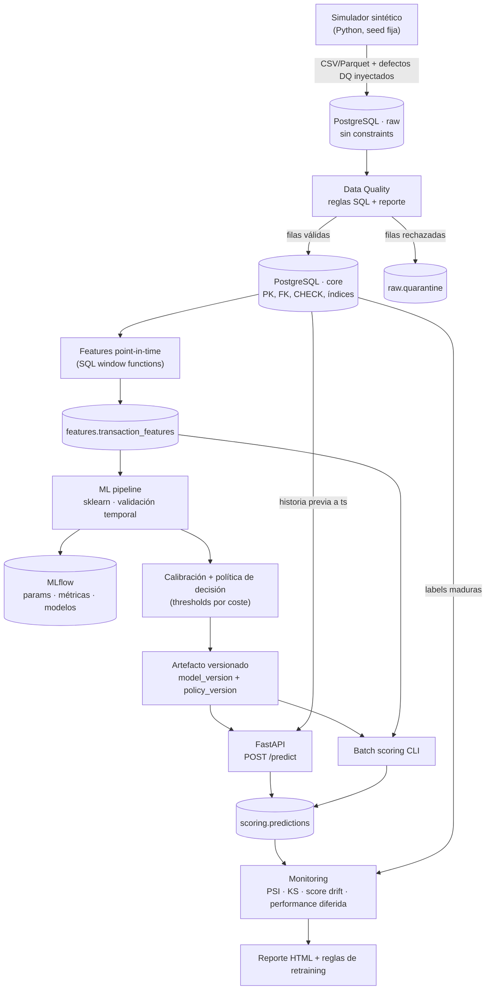
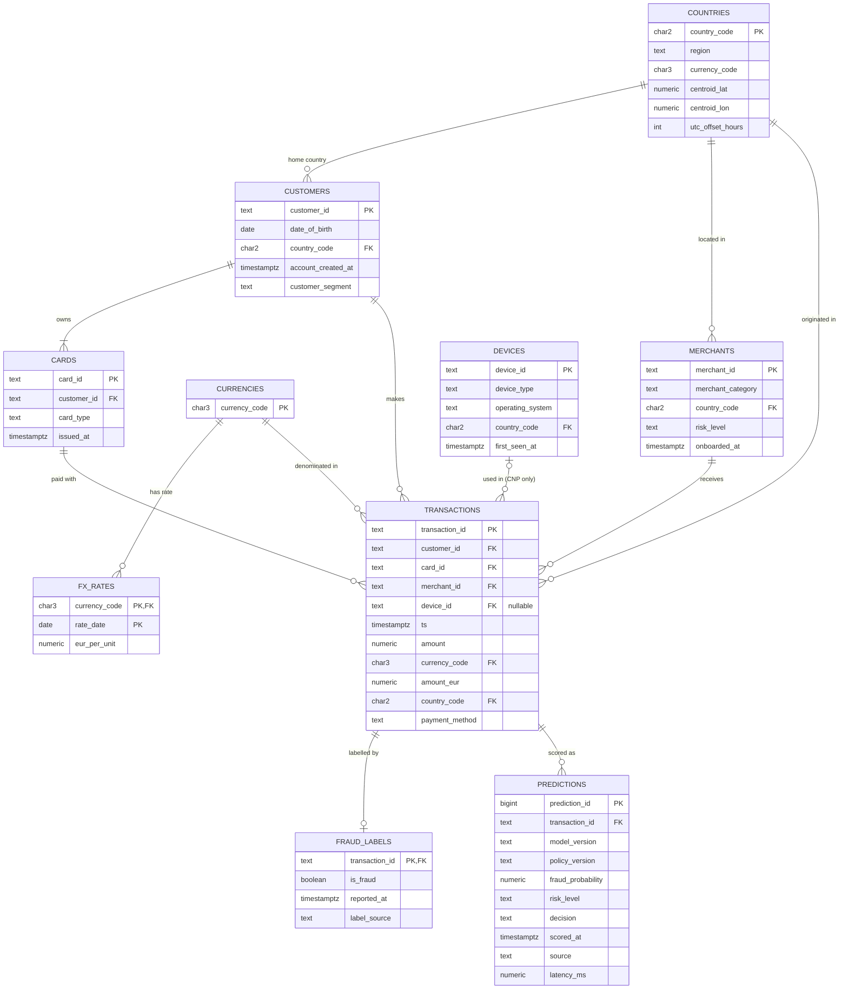

# Fase 1 — Diseño técnico

**Proyecto:** Transaction Fraud Detection & Risk Scoring Platform
**Estado:** borrador para validación (no hay código ni resultados todavía)
**Fecha:** 2026-10-20

> Regla de honestidad: este documento **no contiene ningún resultado**. Todo número que aparece
> es un **supuesto de diseño** (marcado como tal) o un **objetivo** a verificar empíricamente.

---

## 0. Resumen de decisiones

| Tema | Decisión | Por qué (en una línea) |
|---|---|---|
| Datos | Simulador sintético por **escenarios de fraude**, ~3M transacciones, 24 meses, fraude ~1% | Ningún dataset público tiene customers + cards + merchants + devices + tiempo real |
| Etiquetas | Tabla separada `fraud_labels` con **`reported_at`** (las etiquetas llegan con retraso) | Así funciona el fraude real (chargebacks); es la fuente de leakage más sutil |
| Base de datos | PostgreSQL 16 en Docker, esquemas `raw` → `core` → `features` → `scoring` → `monitoring` | Window functions con `RANGE INTERVAL`, constraints reales, gratis y estándar |
| Features | Definidas en **SQL point-in-time** (solo historia estrictamente anterior), mismas definiciones offline y online | Evita leakage y training/serving skew; un test de paridad lo verifica |
| Validación | Train 12m → Validation 3m → Test 3m → **Producción simulada 6m con drift** | Validación temporal + un periodo "seis meses después" real para monitoring |
| Métrica de modelo | PR-AUC (Average Precision) | Con 1% de fraude, accuracy y ROC-AUC engañan |
| Métrica de negocio | Coste esperado en € **dependiente del importe** + **capacidad de revisión limitada** | Dejar pasar un fraude de 3 € no cuesta lo mismo que uno de 2.000 € |
| Decisión | approve / review / block optimizados por coste, no thresholds fijos | El threshold 0.5 no tiene sentido con base rate del 1% |
| Tracking | MLflow local | Comparar experimentos con dataset/feature/model version |
| Fuera de alcance | Kafka, Airflow, Spark, Kubernetes, feature store, cloud | No resuelven un problema que tengamos a esta escala |

---

## 1. Problema de negocio

### 1.1 Contexto
Una fintech europea (ficticia) emite tarjetas y procesa sus pagos. Cada transacción pasa por un
motor de autorización que debe decidir en el momento:

| Decisión | Qué significa operativamente |
|---|---|
| `approve` | Se autoriza sin fricción |
| `review` | Se retiene: autenticación reforzada (OTP/3DS) o cola de analista antes de liquidar |
| `block` | Se deniega |

> Nota de realismo: en un pago con tarjeta física no puedes "esperar a un analista" con el cliente
> en la caja. Por eso definimos `review` como *step-up authentication o retención previa a
> liquidación*. Lo documentamos como supuesto en vez de fingir que la revisión manual es instantánea.

### 1.2 Pregunta que responde el sistema
> "Dada esta transacción y **toda la información disponible hasta ese instante**,
> ¿cuál es la probabilidad de que acabe confirmada como fraude?"

- **Unidad de predicción:** una transacción en el momento de autorización.
- **Target:** `is_fraud = 1` si la transacción es confirmada como fraude (chargeback, denuncia del
  cliente o investigación) dentro de una **ventana de maduración de 120 días**.
- **Salida:** `fraud_probability ∈ [0,1]` **calibrada** + `risk_level` + `decision`.

### 1.3 Objetivo
Minimizar el **coste total esperado** (fraude no detectado + clientes legítimos bloqueados +
coste de revisiones), **sujeto a una capacidad de revisión diaria limitada**. No maximizar accuracy.

### 1.4 Usuarios del sistema
| Usuario | Cómo lo usa |
|---|---|
| Motor de autorización | `POST /predict` síncrono |
| Equipo de Fraud Ops | Cola de `review` ordenada por riesgo |
| Risk analysts | Scoring batch diario, reportes de monitoring |
| Model owner (tú) | MLflow, model card, alertas de drift |

### 1.5 Qué significa "real-time" en este proyecto (honestidad de alcance)
API síncrona que calcula features consultando la historia en PostgreSQL y responde en una sola
petición. **No** construimos infraestructura de streaming. Mediremos la latencia (p50/p95) en lugar
de prometerla.

---

## 2. Arquitectura

### 2.1 Diagrama de componentes



### 2.2 Decisiones de arquitectura clave

1. **Capas raw → core.** `raw` acepta cualquier cosa (texto, sin FK) porque los datos reales llegan
   sucios; si `raw` tuviera constraints, los datos inválidos ni siquiera se podrían cargar para
   detectarlos. `core` tiene todas las garantías. Lo rechazado va a cuarentena con el motivo.
2. **Una sola definición de cada feature.** La lógica point-in-time vive en SQL. Offline se aplica
   a toda la tabla; online (API) se aplica a una sola transacción contra la historia. Un **test de
   paridad** comprueba que ambas rutas dan el mismo valor para una muestra de transacciones.
3. **Modelo y política separados.** El modelo devuelve P(fraude). La política (thresholds) depende
   de supuestos de coste que negocio puede cambiar sin reentrenar → se versionan por separado.
4. **Orquestación con una CLI** (`fraud simulate | load | dq | features | train | score | monitor`),
   no con Airflow: el pipeline es lineal y se ejecuta en un portátil.

### 2.3 Estructura del repositorio (cambios respecto a la propuesta)

```
fraud-detection-platform/
├── README.md · LICENSE · pyproject.toml · Dockerfile · docker-compose.yml
├── configs/
│   ├── simulation.yaml        # escala, seed, mezcla de escenarios, drift
│   ├── features.yaml          # ventanas, versión del feature set
│   ├── costs.yaml             # SUPUESTOS de coste (documentados)
│   └── model.yaml             # espacios de búsqueda, splits
├── data/{raw,processed,sample}/   # ignorado en git salvo sample/
├── sql/
│   ├── schema/                # 01_raw.sql, 02_core.sql, 03_features.sql, ...
│   ├── data_quality/          # una regla por fichero o bloque
│   ├── features/              # velocity, device, geo, history
│   └── analysis/              # consultas analíticas del EDA
├── notebooks/                 # 01_data_quality … 05_error_analysis (solo análisis)
├── src/fraudplatform/         # paquete instalable (src-layout)
│   ├── config.py · cli.py · db.py · logging.py
│   ├── simulation/  data/  quality/  features/
│   ├── models/  decision/  scoring/  monitoring/
│   └── api/                   # main.py, schemas.py
├── tests/{unit,integration}/
├── reports/                   # model_card.md, final_report.md, figuras
├── docs/                      # phase1_design.md, decisions.md, architecture.md
└── .github/workflows/ci.yml · .github/pull_request_template.md
```

Cambios y motivo:
- `api/` y `monitoring/` **dentro del paquete** `src/fraudplatform/`: evita hacks de `sys.path` y
  duplicar un `monitoring/` fuera y otro dentro de `src/`.
- **src-layout con nombre de paquete** (`fraudplatform`), no `src.data...`: los imports funcionan
  igual en tests, Docker y CLI.
- `configs/` separado: los supuestos de coste y simulación son decisiones de negocio, no código.
- Los notebooks **importan** del paquete; no contienen lógica que la API o el batch necesiten.

---

## 3. Dataset

### 3.1 ¿Hay un dataset público adecuado?

| Dataset | A favor | Por qué no sirve como fuente principal |
|---|---|---|
| ULB Credit Card Fraud (Kaggle, 284k, 2 días) | Real | Features PCA anónimas (V1–V28), solo 2 días, sin entidades: imposible SQL relacional o velocity |
| IEEE-CIS Fraud Detection (Vesta) | Real y rico | Tiempo relativo, sin `customer_id` (hay que inferirlo), cientos de columnas sin semántica, licencia de competición que impide redistribuirlo en el repo |
| PaySim | Temporal | Mobile money: sin merchants, cards ni devices; el fraude se deduce casi directamente de los campos de saldo |
| Sparkov ("Credit Card Transactions Fraud Detection", Kaggle) | Customers, merchants, categorías, fechas reales | Sin devices ni payment method, un solo país |
| IBM TabFormer | Grande, users/cards/merchants | Sin devices, casi todo en un país, muy pesado |

**Decisión:** simulador sintético propio como fuente principal (ADR-002).
**Opcional (Fase 7):** aplicar la misma metodología a Sparkov como *sanity check externo* sobre
datos que no hemos diseñado nosotros.

### 3.2 El riesgo de un dataset sintético (y cómo lo gestionamos)
Si yo diseño el generador, el modelo puede acabar aprendiendo **mis propias reglas** — es circular.
Un entrevistador lo preguntará. Mitigaciones:

1. El fraude se genera por **escenarios de comportamiento** (mecanismos latentes), no por una
   fórmula sobre las columnas. Las features no son los inputs del generador.
2. **Ruido deliberado:** comportamiento legítimo que parece fraude (viajes, móvil nuevo, dispositivos
   compartidos en familia) y fraude que parece legítimo (escenario *stealth*).
3. **Ruido en las etiquetas:** fraude que nunca se reporta y disputas falsas (*friendly fraud*).
4. **Congelar el generador** (`simulation_version = 1.0`) **antes** de modelar. Cambiarlo después
   para "mejorar resultados" está prohibido; cualquier cambio sube versión y se documenta el motivo.
5. Lo que **sí** demuestra el proyecto: metodología (leakage, validación temporal, coste,
   calibración, drift), no que hayamos descubierto patrones de fraude reales.

### 3.3 Escala (configurable)

| Parámetro | `full` (objetivo) | `small` (dev/CI) |
|---|---|---|
| Periodo | 2024-07-01 → 2026-06-30 (24 meses) | 3 meses |
| Customers | ~30.000 | ~1.000 |
| Cards | ~45.000 | ~1.500 |
| Merchants | ~4.000 | ~300 |
| Devices | ~50.000 | ~1.500 |
| Transacciones | ~3M (objetivo, a verificar) | ~50k |
| Tasa de fraude | objetivo 0,7%–1,2% (a verificar empíricamente) | similar |

Máquina disponible: 16 GB RAM, 20 hilos — suficiente para `full`.

### 3.4 Tablas de referencia
- `countries`: ~12 países ISO (ES como mercado principal + UE + algunos extra-UE), con región,
  divisa, **centroide lat/lon** y desfase UTC fijo.
  El *risk tier* por país es un **parámetro sintético de configuración, no una afirmación sobre
  países reales**. El principal mecanismo geográfico de riesgo es el **desajuste** (cross-border,
  viaje imposible), no la nacionalidad.
- `currencies` y `fx_rates` diarios (sintéticos) → `amount_eur` con el tipo de cambio de ese día.

### 3.5 Comportamiento legítimo (cómo se genera)
| Elemento | Modelo generativo |
|---|---|
| Actividad | Proceso de Poisson no homogéneo por cliente: tasa base por segmento × curva horaria × día de semana × efecto día de cobro |
| Merchants | Conjunto preferido por cliente con distribución tipo Zipf (unos pocos merchants concentran el gasto) |
| Importe | Lognormal por categoría × multiplicador de segmento × multiplicador individual |
| Viajes | ~2–3% de clientes/mes viajan 3–14 días → transacciones legítimas en otro país (**generan falsos positivos realistas**) |
| Devices | 1–2 por cliente; cambio de móvil legítimo ~1 vez/año; dispositivos compartidos en familia |
| Altas | Clientes y tarjetas nuevos durante todo el periodo (cold start real) |
| Payment method | `chip_pin`, `contactless` (presencial, **sin device**), `ecommerce`, `mobile_wallet` (con device) |

### 3.6 Escenarios de fraude

| # | Escenario | Mecanismo | Señal esperada | Peso aprox. (supuesto) |
|---|---|---|---|---|
| F1 | Card testing | Ráfaga de 3–10 micro-pagos (0,5–5 €) en minutos en merchants digitales y luego 1–3 compras grandes | velocity, importes pequeños repetidos | 25% |
| F2 | Account takeover | Device nuevo (a veces otro país/OS) → varias compras caras (electrónica, gift cards) en horas | new_device, amount ratio, categoría | 25% |
| F3 | Tarjeta clonada presencial | Pagos presenciales en otro país mientras el cliente acaba de pagar en casa | viaje imposible, country change | 15% |
| F4 | Fraud ring / granja de devices | Pocos devices usados con muchas tarjetas robadas de clientes distintos | cards/customers por device | 15% |
| F5 | Merchant comprometido | Tarjetas usadas en un merchant comprometido sufren fraude 1–6 semanas después | difícil sin labels históricas → trampa de leakage | 10% |
| F6 | Stealth | Importe, merchant y device coherentes con el perfil del cliente | casi ninguna → **suelo de error irreducible** | 10% |

**Ruido de etiquetas (supuestos):** ~5–10% del fraude nunca se reporta; ~0,05% de transacciones
legítimas se disputan como fraude.
**Retraso de etiquetas:** `reported_at = ts + delay`, lognormal (mediana ~3 semanas, máx. 120 días);
el card testing se detecta antes.

**Drift inyectado (solo en producción simulada, desde 2026-03-01), documentado:**
- Nuevo patrón de fraude: aprovisionamiento de tarjetas en `mobile_wallet` desde devices recién vistos.
- Cambio legítimo: más peso del canal online y subida de importes (~inflación).

El objetivo de monitoring es **detectar esto sin mirar el generador**.

### 3.7 Defectos de calidad inyectados (solo en `raw`)
Como sabemos exactamente qué filas son defectuosas, podremos medir el **recall de nuestras reglas
de DQ** — algo que en la vida real no se puede hacer.

| Defecto | Tasa (supuesto) |
|---|---|
| Duplicados exactos (reintentos) | 0,2% |
| `transaction_id` repetido con contenido distinto | 0,02% |
| Importe ≤ 0 o nulo | 0,05% |
| Divisa inválida (`XXX`, `EURO`, minúsculas) | 0,05% |
| Timestamp futuro o anterior a la emisión de la tarjeta | 0,03% |
| FK rota (customer/merchant inexistente, tarjeta de otro cliente) | 0,03% |
| País de transacción presencial ≠ país del merchant | 0,05% |
| Device "centinela" (`unknown`, `000000`) compartido por miles de clientes | patrón realista |

### 3.8 Ground truth del simulador
El escenario que generó cada fraude se guarda en un esquema aparte `sim.ground_truth`. **Los
modelos y las features nunca lo leen** (un test lo verifica). Solo se usa en error analysis
("¿qué tipo de fraude se nos escapa?"), una ventaja honesta de tener datos sintéticos.

---

## 4. Esquema de base de datos

### 4.1 Esquemas PostgreSQL
| Esquema | Contenido |
|---|---|
| `raw` | Copia fiel de los ficheros: tipos `text`, sin constraints + `raw.quarantine` |
| `core` | Modelo limpio con PK, FK, CHECK, índices |
| `features` | Tabla de features materializada, versionada |
| `scoring` | Predicciones (API y batch) |
| `monitoring` | Métricas de drift y rendimiento por ventana |
| `sim` | Ground truth del simulador (fuera del alcance de los modelos) |

### 4.2 Diagrama entidad-relación (`core`)



### 4.3 Cambios respecto al esquema propuesto (y por qué)

| Propuesta original | Cambio | Motivo |
|---|---|---|
| `customers.age` | `date_of_birth` | La edad cambia con el tiempo; una columna `age` estática da la edad *de hoy*, no la del momento de la transacción |
| `transactions.is_fraud` | Tabla `fraud_labels(is_fraud, reported_at, label_source)` | La etiqueta no existe en el momento de la transacción; llega semanas después. Sin `reported_at` es imposible construir features históricas de fraude sin leakage |
| `transactions.device_id` obligatorio | Nullable, solo en `ecommerce`/`mobile_wallet` | En un pago presencial no hay device del cliente. La regla de DQ debe distinguir "nulo legítimo" de "nulo erróneo" |
| `transactions.country` (ambiguo) | Definido: país donde se origina (terminal en presencial, geolocalización IP en online) | Sin definición, `merchant_country_mismatch` no significa nada |
| `devices.country` | `country_code` = país del **primer** uso + `first_seen_at` | Si fuera "último país visto" se actualizaría con el tiempo → leakage (dimensión mutable) |
| — | `amount_eur`, `fx_rates` | Comparar importes en divisas distintas |

### 4.4 Constraints e índices

```sql
-- La tarjeta debe pertenecer al cliente de la transacción (FK compuesta)
ALTER TABLE core.cards ADD CONSTRAINT uq_card_customer UNIQUE (card_id, customer_id);
ALTER TABLE core.transactions
  ADD CONSTRAINT fk_txn_card_customer
  FOREIGN KEY (card_id, customer_id) REFERENCES core.cards (card_id, customer_id);

ALTER TABLE core.transactions ADD CONSTRAINT ck_amount_positive CHECK (amount > 0);
ALTER TABLE core.transactions ADD CONSTRAINT ck_device_channel
  CHECK (device_id IS NOT NULL OR payment_method IN ('chip_pin', 'contactless'));

-- Índices pensados para las features point-in-time (entidad, tiempo)
CREATE INDEX ix_txn_card_ts     ON core.transactions (card_id, ts);
CREATE INDEX ix_txn_customer_ts ON core.transactions (customer_id, ts);
CREATE INDEX ix_txn_device_ts   ON core.transactions (device_id, ts) WHERE device_id IS NOT NULL;
CREATE INDEX ix_txn_merchant_ts ON core.transactions (merchant_id, ts);
CREATE INDEX brin_txn_ts        ON core.transactions USING brin (ts);   -- escaneos por rango de fechas
CREATE INDEX ix_labels_reported ON core.fraud_labels (reported_at);
```

Particionado mensual de `transactions`: **no** a 3M filas (coste de complejidad > beneficio).
Se documenta como mejora si el volumen creciera 100×.

---

## 5. Hipótesis

Importante: algunas hipótesis son **parcialmente ciertas por construcción** (las metí en el
generador). Lo que no está garantizado es que nuestras features recuperen la señal con ruido, ni
que el modelo generalice en el tiempo. Lo marcamos explícitamente.

| # | Hipótesis | ¿Por construcción? | Cómo se contrasta |
|---|---|---|---|
| H1 | Las features de velocity por tarjeta mejoran PR-AUC sobre features solo de la transacción | Parcial (F1) | Ablación por grupos de features |
| H2 | El importe **relativo** al historial del cliente es más informativo que el importe bruto | Parcial | PR-AUC univariante + ablación |
| H3 | Las features de grafo de devices detectan F4, pero generan FPs en dispositivos compartidos legítimos | Parcial | Error analysis por escenario |
| H4 | Gradient boosting supera a regresión logística por interacciones (device nuevo × importe alto × categoría) | No | LR con y sin términos de interacción vs HGB |
| H5 | RF/HGB salen mal calibrados; Platt/isotonic mejoran Brier sin empeorar PR-AUC | No | Curvas de calibración en validation |
| H6 | El threshold de coste óptimo está muy por debajo de 0,5 y depende del importe | No (consecuencia del coste) | Curva coste vs threshold |
| H7 | CV aleatoria sobreestima PR-AUC frente a CV temporal | No | Mismo modelo, dos esquemas de validación |
| H8 | Features "naive" (no point-in-time) inflan las métricas offline | No | Feature set deliberadamente con leakage vs correcto |
| H9 | En producción simulada, PSI detecta el drift **antes** de que las etiquetas permitan ver la caída de rendimiento | Parcial (drift inyectado) | Timeline de alertas vs métricas con labels maduras |
| H10 | El fraude *stealth* (F6) queda mayoritariamente sin detectar | Sí (es el suelo) | Recall por escenario |
| H11 | Clientes con cuenta reciente (< 30 días) tienen peor rendimiento (cold start) | No | Métricas por segmento |

---

## 6. Variables

### 6.1 Reglas comunes a todas las features históricas
- **Historia = transacciones con `ts` estrictamente anterior** a la transacción actual. La
  transacción actual **no** se cuenta en su propia velocity (en la API todavía no está en la BD;
  si offline la contáramos, habría training/serving skew).
- Empates de timestamp: no se consideran "anteriores" (orden real desconocido) — decisión documentada.
- Etiquetas: solo se usan las que tienen `reported_at < ts`.
- Atributos de dimensiones: solo valores inmutables o conocidos en el momento (`first_seen_at ≤ ts`).

### 6.2 Catálogo

| Grupo | Feature | Por qué puede predecir | Riesgo de leakage / control |
|---|---|---|---|
| **Transacción** | `amount_eur`, `log_amount` | El fraude busca extraer valor | Bajo |
| | `payment_method`, `merchant_category`, `merchant_risk_level` | Online y categorías revendibles concentran fraude | `risk_level`: ¿quién lo calculó y cuándo? Se asume rating externo fijado en el alta |
| | `local_hour`, `day_of_week`, `is_weekend` | El fraude ocurre cuando la víctima duerme | Hora **local** del país de origen, no UTC |
| | `is_cross_border`, `currency_is_foreign` | Uso fuera del patrón habitual | Bajo |
| **Antigüedad / perfil** | `customer_age_at_txn`, `account_age_days`, `card_age_days`, `card_type`, `customer_segment` | Cuentas y tarjetas nuevas son más vulnerables | Calculadas a fecha `ts` |
| **Velocity (card y customer)** | `txn_count_{5m,1h,24h,7d}` | Card testing y ATO generan ráfagas | Ventana `[ts − w, ts)` |
| | `amount_sum_{1h,24h}` | Vaciado rápido de la tarjeta | Ídem |
| | `small_txn_count_1h` (< 5 €) | Firma típica de card testing | Ídem |
| | `time_since_prev_txn` (card, customer) | Intervalos anormalmente cortos | `LAG` sobre historia previa |
| | `unique_merchants_24h`, `unique_countries_24h` | Dispersión anómala | **Postgres no permite `COUNT(DISTINCT)` en window functions** → `LATERAL` o self-join |
| **Perfil relativo** | `amount_ratio_to_median_90d`, `amount_zscore_90d` | "Alto" es relativo a cada cliente | Mediana solo con historia previa; nulo si no hay historia |
| | `merchant_new_for_customer`, `category_new_for_customer` | Fraude = merchants que la víctima nunca usa | Historia previa |
| **Device** | `new_device_for_customer` | ATO usa un device nuevo | Historia previa del cliente |
| | `unique_cards_per_device_{24h,30d}`, `unique_customers_per_device_30d` | Granjas de devices (F4) | **Nunca** el conteo global de toda la tabla |
| | `device_country_mismatch` | Device registrado en otro país | `devices.country_code` = primer uso |
| **Geo** | `country_changed` (vs transacción previa) | Cambio de ubicación | Historia previa |
| | `new_country_for_customer_180d` | País nunca visto | Ídem |
| | `distance_from_prev_km` | Desplazamiento | **Precisión de país**: centroides; mismo país = 0 km. No se inventa precisión |
| | `implied_speed_kmh`, `impossible_travel` | Clonado presencial (F3) | Ídem; umbral documentado (p. ej. > 900 km/h) |
| **Derivadas de etiquetas** (alto riesgo) | `card_prior_confirmed_fraud` | Tarjetas ya comprometidas | Solo `reported_at < ts` |
| | `merchant_fraud_rate_90d_asof` | Merchants comprometidos (F5) | Solo labels ya reportadas + suavizado bayesiano; **sesgo de inmadurez**: las semanas recientes parecen limpias |

Excluidas a propósito: cualquier ID como feature (`transaction_id` es monótono con el tiempo), el
`label_source`, cualquier columna de `sim.*`.

### 6.3 Experimento de control: feature set con leakage
Construiremos también una versión **incorrecta** (conteos globales, ventanas centradas, labels sin
`reported_at`) para **cuantificar** cuánto infla las métricas. Es la forma más convincente de
demostrar que entiendes el leakage: medirlo, no solo describirlo.

---

## 7. Leakage temporal

### 7.1 Qué es (versión corta)
| | |
|---|---|
| **Qué es** | Que el modelo use, durante el entrenamiento o la evaluación, información que no existiría en el momento de la predicción |
| **Para qué importa** | Las métricas offline salen excelentes y el modelo falla en producción |
| **Por qué aquí especialmente** | Las features son agregados históricos, las etiquetas llegan con retraso y el fraude ocurre en campañas |
| **Qué evita controlarlo** | Desplegar un modelo cuyo rendimiento real es muy inferior al reportado |
| **Alternativa** | No la hay; solo grados de rigor en cómo se previene y se detecta |

### 7.2 Catálogo de riesgos

| ID | Riesgo | Cómo aparece | Prevención | Detección |
|---|---|---|---|---|
| L1 | Ventanas que miran al futuro | `GROUP BY customer_id` sobre toda la tabla, ventanas sin límite superior | `RANGE BETWEEN INTERVAL 'w' PRECEDING ...` excluyendo la fila actual | Test *time-travel* |
| L2 | Agregados globales | "clientes por device" calculado con 24 meses | Siempre ventana `[ts − w, ts)` | Test time-travel |
| L3 | Etiquetas aún no conocidas | Usar `is_fraud` de transacciones previas cuyo chargeback llegó después | `reported_at < ts` | Test unitario con fixture de label tardía |
| L4 | Etiquetas inmaduras al entrenar | Transacciones recientes parecen legítimas porque su label no ha llegado | Ventana de maduración (gap) entre train y test | Comparar tasa de fraude por mes de transacción vs fecha de snapshot |
| L5 | Split aleatorio | La misma campaña de fraude y la misma tarjeta en train y test | Split temporal + gap | Experimento H7 |
| L6 | Preprocesado sobre todo el dataset | Scaler, imputer, encoder o caps de outliers ajustados con test | `sklearn.Pipeline` ajustado solo en el fold de train | Revisión de código + test |
| L7 | Dimensiones mutables | `customer_segment` cambiado a "bloqueado" tras el fraude; `device.country` = último visto | Atributos inmutables; prohibido usar `status` | Revisión del esquema |
| L8 | Ground truth del simulador | Leer `sim.ground_truth` | Esquema separado | Test que analiza el SQL de features |
| L9 | Threshold/calibración ajustados en test | "Elegir el mejor threshold" mirando test | Validation separado; test se toca **una vez** | Proceso + MLflow |
| L10 | Tuning con datos futuros | CV aleatoria dentro de `RandomizedSearchCV` | `TimeSeriesSplit` (con gap) dentro del periodo de train | Configuración revisada |
| L11 | IDs como features | El modelo memoriza el orden temporal | Lista explícita de columnas permitidas | Test de columnas esperadas |
| L12 | Zonas horarias y empates | Timestamps mezclados UTC/local; dos transacciones en el mismo segundo | `timestamptz` en UTC; empates no cuentan como previos | Test |

### 7.3 Técnicas de detección concretas
1. **Test time-travel:** para una muestra de transacciones, recalcular sus features usando una BD
   truncada a `ts` y comparar con la tabla materializada. Deben ser idénticas.
2. **Test de paridad offline/online:** la API y el batch deben dar las mismas features.
3. **Sospecha por métricas:** una feature con PR-AUC univariante altísimo se investiga antes de celebrarla.
4. **Gap entre validación aleatoria y temporal** (H7) y **feature set con leakage** (6.3).

---

## 8. Estrategia de validación temporal

```
2024-07 ─────────────── 2025-06 │ 2025-07 ── 09 │ 2025-10 ── 12 │ 2026-01 ──────────── 2026-06
          TRAIN (12m)           │ VALIDATION 3m │   TEST 3m     │ PRODUCCIÓN SIMULADA 6m
  TimeSeriesSplit + tuning      │ calibración + │ se toca UNA   │ batch diario + monitoring
                                │ thresholds    │ vez           │ drift desde 2026-03
```

- **CV interna (solo en TRAIN):** expanding window, 4 folds, con **gap** entre train y test de cada
  fold para que las ventanas de velocity y la maduración de labels no se solapen.
- **Validation:** calibración (Platt/isotonic) y optimización de la política de coste.
- **Test:** evaluación final, intervalos de confianza por *block bootstrap* por días (las
  transacciones de una misma campaña no son independientes).
- **Producción simulada:** las etiquetas se van revelando según `reported_at`; el rendimiento solo
  se puede medir con retraso — exactamente el problema real de monitoring.
- **Simplificación declarada:** la evaluación offline (train/val/test) es un estudio retrospectivo
  con etiquetas maduras. El retraso de etiquetas afecta a las features derivadas de labels, al
  monitoring y a la estrategia de retraining.

---

## 9. Métricas

| Nivel | Métrica | Uso |
|---|---|---|
| Referencia | **Base rate** | Un modelo aleatorio tiene PR-AUC ≈ base rate (~0,01). Ancla para interpretar todo lo demás |
| Ranking | **PR-AUC (Average Precision)** | Selección de modelos |
| | ROC-AUC | Se reporta, no decide (con desbalance extremo parece buena aunque la precisión sea mala) |
| | Recall @ capacidad de revisión | "Con K revisiones/día, ¿cuánto fraude cazamos?" |
| Probabilidades | Brier score, log loss, curva de calibración | Si `0,3` significa realmente 30% |
| Negocio | **Coste total esperado (€)**, coste por 1.000 transacciones | Selección de la política |
| | Ahorro vs `approve-all` y vs reglas baseline | ¿Aporta valor el ML? |
| | Recall ponderado por importe (€ de fraude detectado / € de fraude total) | No todos los fraudes valen lo mismo |
| | False decline rate, review rate, block rate | Experiencia de cliente y operaciones |
| Servicio | Latencia p50/p95, tasa de error | API |
| Monitoring | PSI, KS, media de score, % high-risk, métricas por cohorte madura | Fase 12 |

Accuracy se reporta una sola vez, para mostrar por qué engaña (un modelo que aprueba todo tendría
~99% de accuracy).

---

## 10. Modelo de coste

### 10.1 Por qué no costes planos
Con un coste fijo de 500 € por falso negativo, dejar pasar un card test de 2 € "cuesta" igual que
un portátil de 2.000 €. En la práctica la pérdida principal es el **importe**. Por eso el coste
depende del importe `A` (en €).

### 10.2 Supuestos (en `configs/costs.yaml`, todos ajustables)

| Símbolo | Supuesto | Valor inicial | Justificación |
|---|---|---|---|
| `F` | Comisión + gestión de chargeback | 15 € | Coste operativo por disputa |
| `c_r` | Coste de una revisión | 4 € | ~4 min de analista |
| `ρ` | Recall del analista/step-up sobre fraude revisado | 0,90 | La revisión no es perfecta |
| `f_r` | Fricción por revisar a un cliente legítimo | 1 € | Retraso/OTP |
| `m` | Margen perdido al bloquear un legítimo | 2% de `A` | Interchange/comisión |
| `f_b` | Fricción por bloqueo injusto (soporte, churn) | 10 € | Contacto con soporte, riesgo de baja |
| `K` | Capacidad de revisión diaria | parámetro (≈ 2× fraudes diarios esperados) | Restricción operativa |

Simplificación: asumimos que la fintech absorbe el 100% de la pérdida por fraude (sin liability
shift por 3DS).

### 10.3 Coste esperado de cada acción (dado `p = P(fraude)`)

```
E[approve] = p · (A + F)
E[review]  = c_r + p · (1 − ρ) · (A + F) + (1 − p) · f_r
E[block]   = (1 − p) · (m · A + f_b)
```

Ejemplo con los supuestos de arriba (aritmética, no resultados):

| Importe | approve si | review si | block si |
|---|---|---|---|
| 20 € | p < 0,154 | 0,154 ≤ p < 0,419 | p ≥ 0,419 |
| 200 € | p < 0,026 | 0,026 ≤ p < 0,261 | p ≥ 0,261 |

Conclusión de diseño: **los thresholds óptimos dependen del importe**, y para importes altos el
umbral de revisión es muy inferior a 0,5.

### 10.4 Dos políticas a comparar (Fase 8)
1. **P1 — Thresholds globales** `(t_review, t_block)`: grid search en validation minimizando el
   coste realizado, sujeto a `reviews/día ≤ K`. Produce la gráfica *threshold vs coste esperado*
   (y un heatmap 2D).
2. **P2 — Decisión por transacción** (argmin del coste esperado con `p` calibrada y `A`), llenando
   la capacidad de revisión con las transacciones de mayor beneficio esperado. **Solo es válida si
   las probabilidades están calibradas** → por eso la calibración es necesaria y no decorativa.

### 10.5 Análisis de sensibilidad
Variar `F`, `c_r`, `f_b`, `ρ` y `K` (±50%) y ver cuánto cambian la política óptima y el coste.
Mensaje: **los números son supuestos; el entregable es el método.**
Limitación conocida: bloquear un card test pequeño evita fraudes grandes posteriores; el coste
por transacción no captura ese efecto en cadena.

---

## 11. Baselines y modelos

| Modelo | Papel |
|---|---|
| B0 `approve-all` | Coste de referencia (no hacer nada) |
| B1 Umbral de importe | Una sola regla, ajustada en train |
| B2 Reglas de experto | 3–5 reglas como las escribiría un analista (importe alto + device nuevo; > N transacciones en 1h; viaje imposible), usando las **mismas** features point-in-time |
| M1 Logistic Regression | Lineal, interpretable, calibrada de serie; `class_weight` |
| M2 Random Forest | No lineal; suele salir mal calibrado (H5) |
| M3 HistGradientBoosting | Candidato principal; maneja nulos y escalas sin preprocesado pesado |

Criterio de éxito: ML debe batir a **B2** en coste en test, con intervalos que no se solapen. Si no
lo consigue, se dice.

Desbalance: se compararán `class_weight` y threshold tuning. SMOTE **no** se aplica por defecto:
genera transacciones interpoladas que no existen (p. ej. mezcla de dos tarjetas con historias
incompatibles) y distorsiona las probabilidades, lo que rompe la calibración que necesitamos para P2.
Solo se probaría si `class_weight` resultara claramente insuficiente.

---

## 12. Lo que NO vamos a usar (y por qué)

| Tecnología | Motivo |
|---|---|
| Kafka / streaming | Una API síncrona contra Postgres basta para demostrar scoring online |
| Airflow / Prefect | Pipeline lineal en una máquina → CLI |
| Spark | 3M filas caben en Postgres + pandas |
| Feature store (Feast) | El problema que resuelve (paridad offline/online) lo cubrimos con SQL compartido + test |
| Kubernetes / despliegue cloud | Fuera del objetivo; Docker basta para reproducibilidad |
| DVC | El dataset se regenera de forma determinista (seed + versión del simulador); se registra su hash en MLflow |
| Deep learning / GNN | Tabular con pocas features: GBM es el estándar; un GNN sería una mejora futura para el grafo de devices |

---

## 13. Riesgos del proyecto

| Riesgo | Mitigación |
|---|---|
| Circularidad del dataset sintético | Sección 3.2 + sanity check opcional con Sparkov + honestidad en el README |
| Features `COUNT(DISTINCT)` en ventana lentas en Postgres a 3M filas | Índices (entidad, ts); medir; si es inviable, calcular esas features en Python con la misma semántica y testear paridad |
| Ajustar el simulador hasta que "salga bien" | Generador congelado y versionado antes de la Fase 6 |
| Scope creep | Cada fase con criterio de salida; lo opcional va a "Future improvements" |
| Entorno Windows | Todo dentro de Docker (Postgres, API); el código Python es multiplataforma; CI en Linux |

---

## 14. Roadmap

Cada fase = una rama `feature/...` + un Pull Request con objetivo, cambios, validación y riesgos.
**Cambio propuesto:** CI mínima (ruff + pytest) desde la Fase 2, no en la Fase 11 — los tests se
escriben junto al código. La Fase 11 la amplía (Postgres en CI, Docker build).

| Fase | Rama | Entregables | Criterio de salida |
|---|---|---|---|
| 2 | `feature/simulator-and-db` | Simulador por escenarios, `docker-compose` con Postgres, esquemas `raw`/`core`, carga, CI mínima | Misma seed → mismo hash de datos; tasa de fraude en rango objetivo; reporte de mezcla de escenarios |
| 3 | `feature/data-quality-sql` | Reglas DQ en SQL, cuarentena, reporte DQ, consultas analíticas (CTE, window, HAVING, subqueries) | Recall de cada regla DQ medido contra los defectos inyectados |
| 4 | `feature/eda` | Notebook EDA + estadística: base rate, skewness, outliers, tasas de fraude con **intervalos de Wilson**, Cramér's V / Spearman, distribución del retraso de labels | Hallazgos escritos, incluidos los que no salen como se esperaba |
| 5 | `feature/temporal-features` | SQL point-in-time, tabla materializada, tests time-travel y de no-negatividad, feature set con leakage | Tests time-travel en verde; análisis univariante por feature |
| 6 | `feature/baselines-and-models` | B0–B2, LR, RF, HGB en `Pipeline`, MLflow | Tabla comparativa en validation con base rate de referencia |
| 7 | `feature/temporal-validation` | TimeSeriesSplit con gap, tuning (`RandomizedSearchCV` en RF/HGB, `GridSearchCV` en `C` de LR), experimentos H7 y H8 | Gap aleatoria vs temporal y leaky vs clean cuantificados |
| 8 | `feature/cost-threshold-calibration` | Calibración, curvas, coste, P1 vs P2, capacidad, sensibilidad | Política elegida en validation; test evaluado una vez |
| 9 | `feature/error-analysis` | FP/FN por segmento y escenario, permutation importance + SHAP, borrador de model card | "¿Dónde se equivoca el modelo?" respondido con datos |
| 10 | `feature/api-and-batch` | FastAPI `/predict` + `/health`, features online, batch scoring, test de paridad | Paridad offline/online en verde; latencia medida |
| 11 | `feature/docker-ci` | Dockerfile, compose completo, CI: ruff → pytest (con Postgres) → docker build | CI verde en un PR |
| 12 | `feature/monitoring` | Replay de producción simulada, PSI/KS, drift de predicción, rendimiento diferido, reglas de retraining, reporte HTML | Línea temporal: cuándo salta cada alerta vs cuándo empezó el drift |
| 13 | `feature/documentation` | README, final report, model card, `decisions.md`, arquitectura | Alguien externo puede reproducir el proyecto desde cero |
| 14 | — | Revisión tipo tech lead + preparación de entrevista | Puntuaciones y preguntas |

Estimación honesta: 5–8 semanas a tiempo parcial. Las fases 2, 5 y 8 son las más largas.

---

## 15. Preguntas abiertas para validar

1. **Dataset:** ¿de acuerdo con simulador propio + sanity check opcional en Sparkov?
2. **Coste:** ¿coste dependiente del importe + capacidad de revisión, en lugar de costes planos?
3. **Etiquetas:** ¿tabla `fraud_labels` con `reported_at` en lugar de `transactions.is_fraud`?
4. **Idioma del repositorio:** código, README y docs en inglés (recomendado para portfolio) y
   conversación en español, o todo en español.
5. **Escala:** ~3M transacciones / 30k clientes.
6. **Ubicación:** carpeta local del proyecto y nombre del repositorio en GitHub.
