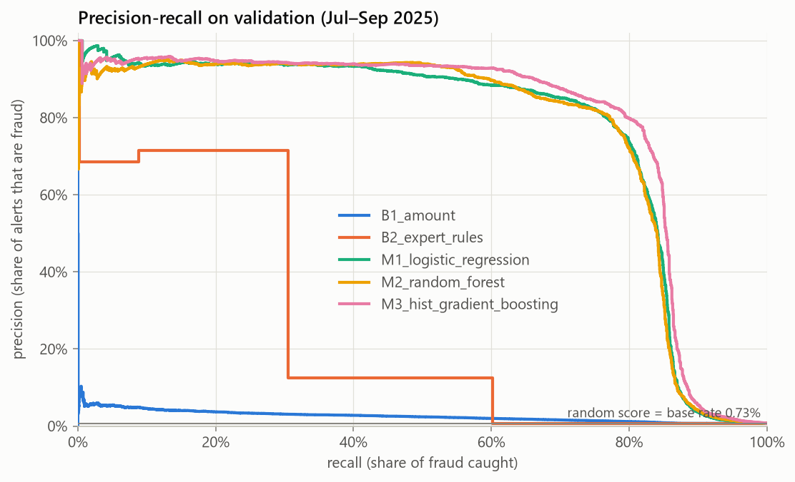

# Phase 6: baselines vs first models (validation)

- dataset: v1.0.1 `350d74bdc988…`
- feature set: v1.0.0 (build 1)
- code: `f032bbb36e` (dirty: False)

Alert metrics assume we can flag the top **0.5%** of transactions.
PR-AUC interval: 95% day-block bootstrap.

| candidate | pr_auc | pr_auc_95ci | roc_auc | precision_at_alert_rate | recall_at_alert_rate | amount_recall_at_alert_rate | brier | mean_predicted | fit_seconds |
|---|---|---|---|---|---|---|---|---|---|
| B0_approve_all | 0.0073 | 0.007 – 0.008 | 0.5000 | 0.3% | 0.2% | 0.1% |  |  | 0.0 |
| B1_amount | 0.0255 | 0.022 – 0.030 | 0.7148 | 5.3% | 3.6% | 30.4% |  |  | 0.0 |
| B2_expert_rules | 0.2556 | 0.235 – 0.283 | 0.7899 | 46.3% | 31.9% | 31.8% |  |  | 0.0 |
| M1_logistic_regression | 0.7663 | 0.745 – 0.792 | 0.9414 | 88.4% | 60.9% | 79.8% | 0.0026 | 0.0072 | 20.6 |
| M1b_logistic_regression_balanced | 0.7208 | 0.697 – 0.751 | 0.9492 | 83.9% | 57.8% | 70.6% | 0.0320 | 0.1233 | 30.4 |
| M2_random_forest | 0.7646 | 0.736 – 0.794 | 0.9443 | 89.0% | 61.3% | 75.5% | 0.0027 | 0.0081 | 85.6 |
| M3_hist_gradient_boosting | 0.7901 | 0.768 – 0.816 | 0.9545 | 91.8% | 63.2% | 83.8% | 0.0023 | 0.0072 | 18.4 |
| M3b_hist_gradient_boosting_balanced | 0.7880 | 0.764 – 0.812 | 0.9528 | 89.0% | 61.3% | 79.2% | 0.0121 | 0.0684 | 20.5 |

